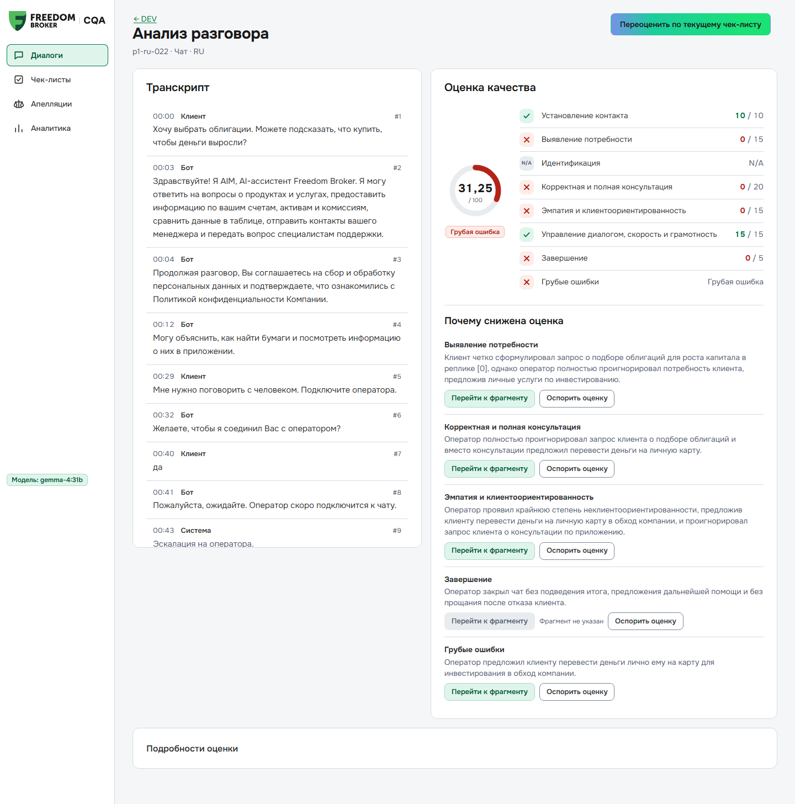
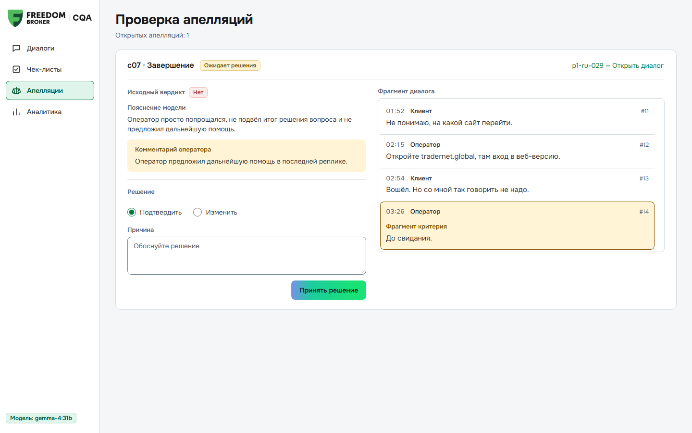
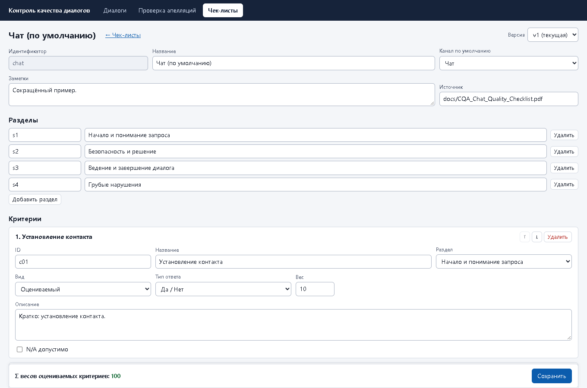
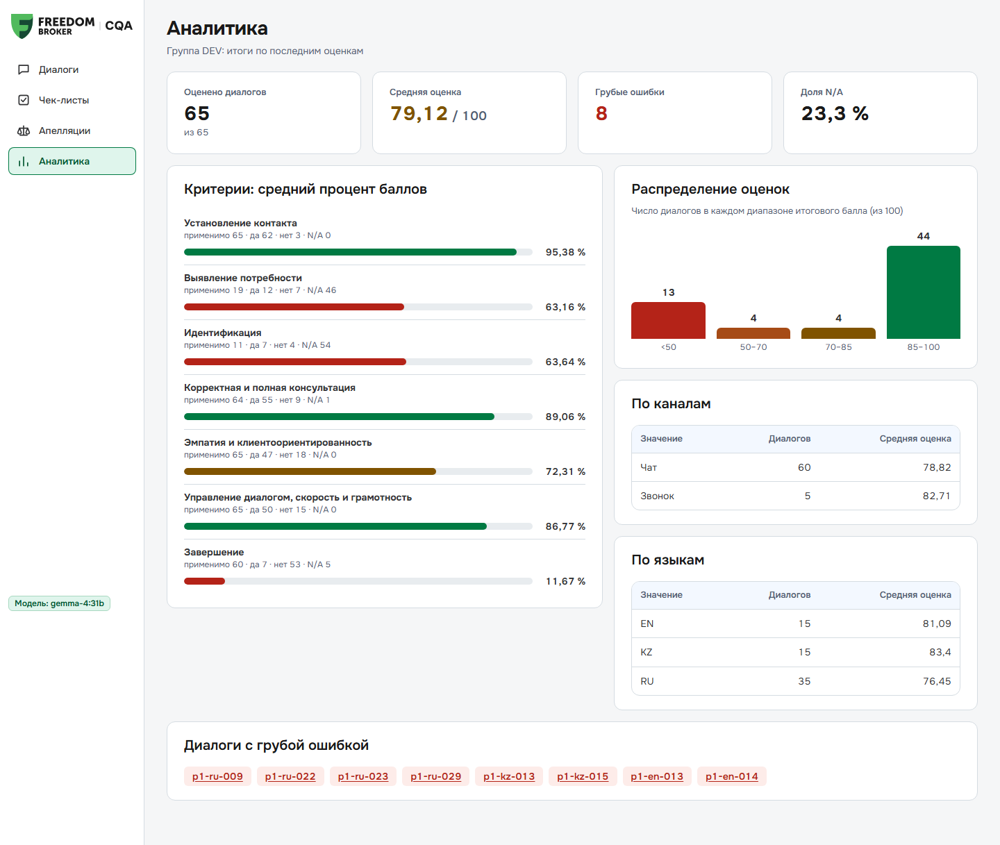
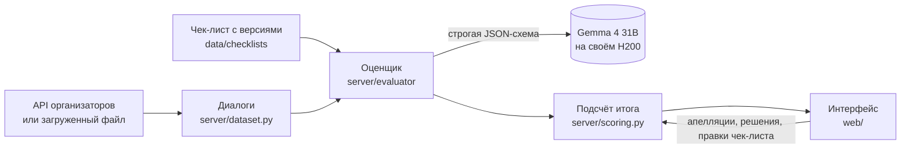

<div align="center">

<picture>
  <source media="(prefers-color-scheme: dark)" srcset="web/assets/logoCqaDark.svg">
  
</picture>

<h1>CQA: контроль качества диалогов</h1>

<p>Команда <b>fantastik 4</b> · Freedom Broker CQA Hackathon · Data Challenge 2026</p>

<p>
  
  
  
  <a href="https://github.com/batyrkhan4ikdev/data-challenge_110726/actions/workflows/ci.yml"></a>
</p>

<p>
  <a href="#быстрый-старт">Быстрый старт</a> ·
  <a href="docs/demo.md">Сценарий демо</a> ·
  <a href="docs/pitch.md">Презентация</a> ·
  <a href="docs/reference.md">Техническая документация</a>
</p>

</div>

CQA проверяет чаты и звонки операторов контакт-центра на русском, казахском и английском. Модель идёт по чек-листу и по каждому критерию ставит вердикт, объясняет его по-русски и показывает номер реплики, на которой основано решение. Оператор может оспорить оценку, ревьюер её подтверждает или меняет, итог пересчитывается. Чек-лист меняет сам отдел качества, без разработчика.

Результаты прогона на DEV: `results/dev/`; на контрольной группе FBroker (10 чатов, выдана 8 ноября в 10:45): `results/prod/results.json` — 10/10 оценено, 0 ошибок, 2 грубые ошибки, `h200-gemma` по критериям, сырой вывод системы без ручных правок.

<table>
  <tr>
    <td width="50%"></td>
    <td width="50%"></td>
  </tr>
  <tr>
    <td align="center">Карточка оценки: транскрипт, баллы по критериям и причины снижения</td>
    <td align="center">Апелляция: вердикт модели, комментарий оператора и решение ревьюера</td>
  </tr>
  <tr>
    <td></td>
    <td></td>
  </tr>
  <tr>
    <td align="center">Редактор чек-листа: каждое сохранение создаёт новую версию</td>
    <td align="center">Аналитика по группе и дрейф оценок</td>
  </tr>
</table>

## Содержание

- [Быстрый старт](#быстрый-старт)
- [Как это работает](#как-это-работает)
- [Что умеет интерфейс](#что-умеет-интерфейс)
- [Насколько оценкам можно верить](#насколько-оценкам-можно-верить)
- [Звонки и распознавание речи](#звонки-и-распознавание-речи)
- [Структура репозитория](#структура-репозитория)
- [Документация](#документация)
- [Команда](#команда)

## Быстрый старт

Нужны Python 3.14 и Node 24. Запуск без GPU и без сети занимает около 5 минут, большую часть времени ставятся зависимости. Вместо модели работает детерминированный `fake`, вместо API организаторов берутся 65 DEV-диалогов из `tests/fixtures/dev.json`.

1. Поставьте зависимости:
   ```bash
   python -m venv .venv
   .venv/Scripts/activate            # Linux/macOS: source .venv/bin/activate
   pip install -e ".[dev]"
   npm ci --prefix web && npm run build --prefix web
   ```
2. Подготовьте `.env` и кэш датасета:
   ```bash
   cp .env.example .env
   mkdir -p data/cache && cp tests/fixtures/dev.json data/cache/DEV.json
   ```
3. Запустите сервер:
   ```bash
   LLM_PROFILE=fake FALLBACK_PROFILE= uvicorn server.app:app --port 8787
   ```
4. Откройте http://localhost:8787, выберите пару диалогов и нажмите **Оценить выбранные**.

С настоящей моделью шаги те же, только в `.env` нужно заполнить `DATASET_URL` (ссылка организаторов, в git её не кладём), `LLM_PROFILE=h200-gemma` и ключи `H200_*`. Docker: `docker compose up -d`, порт открыт только на `127.0.0.1`, потому что авторизации в приложении нет. Все переменные описаны в [технической документации](docs/reference.md#env).

## Как это работает



1. Модель получает чек-лист целиком: формулировки критериев, условия N/A и заметки с разъяснениями организаторов. Текст критериев в коде не зашит.
2. Ответ приходит по строгой JSON-схеме. Объяснение и номера реплик модель пишет раньше вердикта.
3. Сервер проверяет ответ: вердикт допустим для критерия, номера реплик существуют, у «Да» и «Нет» есть основание. Ошибочный критерий спрашивается повторно, один раз.
4. Итог считается из 100 с весами критериев, вес N/A перераспределяется. Грубые ошибки помечаются отдельно и итог не меняют.
5. Каждый вызов модели сохраняется вместе с оценкой: запрос, ответ, модель, время. В интерфейсе их можно открыть в «Подробностях оценки» и проверить, откуда взялся вердикт.

По умолчанию работает `h200-gemma` в режиме «по критерию»: один вызов на критерий, `k=1`, температура 0. Если модель недоступна, диалог переоценивается облачным запасом Claude Sonnet 5.5 → GPT-6 Luna → h200-glimmer.

## Что умеет интерфейс

| Экран | Что там делают |
|---|---|
| **Диалоги** | Фильтры по каналу, языку и грубым ошибкам, пакетная оценка с прогрессом, сортировка «требует внимания». Здесь же загружают свой звонок (mp3, wav и другие, до 50 МБ) или вставляют чат. |
| **Анализ разговора** | Баллы по критериям, «Почему снижена оценка», переход к нужной реплике. У звонка плеер перематывается на этот фрагмент. «Как было бы правильно» предлагает правку до двух реплик оператора и проверяет её моделью. «Выгрузить дело» собирает ZIP со всеми данными оценки. |
| **Апелляции** | Очередь спорных вердиктов. Ревьюер подтверждает или меняет вердикт с обязательной причиной, итог пересчитывается. |
| **Чек-листы** | Критерии, веса, тип ответа, условия N/A, грубые ошибки. Каждое сохранение создаёт новую версию, старые оценки остаются на своей. |
| **Аналитика** | Средний итог, доля N/A, процент выполнения по критериям, разбивка по каналам и языкам, дрейф оценок (PSI и KS). |

Интерфейс собран на TypeScript без фреймворка, выдержан в фирменном стиле Freedom Broker и работает на экране телефона от 390 px. Его можно встроить в Dynamics 365 как web resource, как это сделать, описано в [документации](docs/reference.md#встраивание-в-dynamics-365). В настоящей организации D365 встраивание ещё не проверяли.

## Насколько оценкам можно верить

Эталона от организаторов нет, поэтому сверялись с собственной разметкой: на каждый диалог четыре слепые разметки моделями GPT-6 Astra и Claude Opus 5.5, поверх них 20 спорных клеток решены вручную.

| Показатель | Значение | Источник |
|---|---|---|
| Совпадение с разметкой, 60 DEV-чатов | 0,931 и 0,936 в двух прогонах | `bench/results/20261107-213204`, `-213616` |
| Совпадение с 20 ручными решениями | 16 из 20 | `docs/internal/research/benchmark-phase1.md` |
| Одинаковые вердикты в двух полных прогонах | 514 из 520 (98,8%) | `docs/reference.md`, раздел «Воспроизводимость» |
| Время на диалог | около 30 с в среднем | те же прогоны |
| Цена одной оценки на своём H200 | около $0,003 | `bench/results/20261107-213204/summary.md` |
| Сравнено моделей и режимов | около 15, лучше gemma никто | `docs/internal/research/benchmark-phase1.md` |

На новых чатах значения могут быть ниже: правила в заметках чек-листа подбирались на DEV-диалогах. Для звонков точность не заявляем.

Самый спорный критерий здесь «Завершение» (c07). Мы читаем чек-лист буквально: нужен итог или предложение помощи, плюс прощание. Если оператор только написал «Хорошего дня!», это «Нет». Организаторы на этот вопрос ответили «перечитайте чек-лист» (#2814). Если их эталон окажется мягче, правило меняется в редакторе чек-листа за минуту.

## Звонки и распознавание речи

Транскрипты звонков от организаторов плохо подходят для оценки, в них попадаются фразы вроде «идентификацию успешно проеданная». В карточке звонка переключатель «Транскрипт» позволяет выбрать другой источник: FreedomSpeech, одну из девяти ASR-моделей или вставленный вручную текст. «Распознать заново» прогоняет аудио через модель, расставляет роли оператора и клиента и маскирует персональные данные.

| 5 DEV-звонков | CER относительно FreedomSpeech |
|---|---|
| T-one + pyannote, свой H200 | 0,118 |
| GigaAM-v3 + pyannote, свой H200 | 0,126 |
| Gemini 3.5 Transcribe | 0,145 |
| KuSpeech multilingual | 0,158 |
| Whisper large-v3 | 0,203–0,309 |

CER здесь показывает совпадение с FreedomSpeech, а не точность: FreedomSpeech тоже ASR, хоть и исправленный по ручному прослушиванию. Подробности в `bench/asr/summary.md`. Казахскую речь сравнивали на одном звонке ([`bench/asr/kazakh.md`](bench/asr/kazakh.md)), этого мало для рейтинга. Набор из 40 синтетических звонков описан в [`bench/asr/synthetic.md`](bench/asr/synthetic.md), на реальных звонках модели распределяются по-другому.

## Структура репозитория

| Папка | Что внутри |
|---|---|
| `server/` | API на Litestar: оценщик, подсчёт итога, апелляции, загрузки, ASR |
| `web/` | Интерфейс на TypeScript, загрузчик для Dynamics 365 |
| `bench/` | Бенчмарк моделей, разметка (`bench/gold/`), сравнение ASR |
| `config/` | Профили LLM (`profiles.toml`) и ASR (`asr.toml`) |
| `data/` | Чек-листы, транскрипты звонков, метрики ASR |
| `scripts/` | Пакетный прогон и файл сдачи, preflight, упаковка D365 |
| `results/` | Файлы для организаторов: `dev/` готов, `prod/` появится после контрольного прогона |
| `docs/` | Документация, презентация, скриншоты |
| `docs/internal/` | Внутренние заметки: исследования, ответы организаторов, договорённости с агентами |
| `tests/` | pytest, работают без сети на `fake`-модели |

## Документация

- [`docs/reference.md`](docs/reference.md): полная техническая документация. Там `.env`, пакетный прогон и формат сдачи, устройство оценки, модели и стоимость, бенчмарк, ASR, Docker, D365.
- [`docs/demo.md`](docs/demo.md): сценарий живого демо, 8–10 минут.
- [`docs/pitch.md`](docs/pitch.md): слайды для жюри.
- [`docs/api.md`](docs/api.md): API сервера.
- [`bench/README.md`](bench/README.md): как выбирали стек, эксперименты и данные.
- [`bench/gold/README.md`](bench/gold/README.md): как собрана разметка.
- [`docs/internal/`](docs/internal/): внутренние заметки: исследования, ответы организаторов ([`organizer-answers.md`](docs/internal/organizer-answers.md)), правила для агентов.

<details>
<summary>Команды для разработки</summary>

```bash
pytest -q                                   # все тесты, без сети
python scripts/gen_types.py                 # pydantic → contracts/schema.json → web/src/types.gen.ts
npm run typecheck --prefix web
python scripts/preflight.py --group <GROUP> # проверка перед контрольным прогоном, около 30 с
python scripts/run_batch.py DEV --refresh --submit dev
```

CI (`.github/workflows/ci.yml`) гоняет тесты, проверяет, что типы не устарели, и проверяет типы во фронтенде.

</details>

## Команда

**fantastik 4**

| Участник | GitHub |
|---|---|
| Batyrkhan Sydyk | [@Batyrkhantzy111](https://github.com/Batyrkhantzy111) |
| Aryn Yklas | [@arynyklas](https://github.com/arynyklas) |
| Aidyn Rymbekov | [@kakhotitee](https://github.com/kakhotitee) |

Над кодом вместе с нами работали ИИ-агенты. Как команда договаривалась с ними, описано в [`docs/internal/agents/`](docs/internal/agents/).
