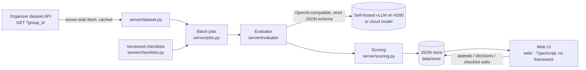

# CQA — Conversation Quality Analytics (Freedom Broker, Data Challenge 2026)

A prototype that scores contact-center operator **chats and calls** (RU / KZ / EN) against a configurable checklist with an LLM judge.

For every criterion it shows:
- the verdict and points;
- an explanation in Russian;
- the evidence turns: a click jumps to the message, and for calls the player seeks to that fragment;
- the turns where a missed action was expected;
- the N/A reason.

The total is weighted, and the weight of N/A criteria is redistributed. Gross errors are flagged separately. Operators file appeals, and a reviewer confirms or changes the verdict; the card keeps the original, the decision and the final result. Checklists are named and versioned, and editing one and re-applying it takes one click.



## Quick start

You need Python 3.14 and Node 24 (the version CI and the Dockerfile use).

```bash
python -m venv .venv && .venv/Scripts/activate        # Linux/macOS: source .venv/bin/activate
pip install -e ".[dev]"
npm ci --prefix web && npm run build --prefix web     # compiles web/src → web/dist
cp .env.example .env                                   # then fill in the values below
uvicorn server.app:app --port 8787                     # open http://localhost:8787
```

### `.env`

| Variable | Meaning |
|---|---|
| `DATASET_URL` | The organizers' GET URL for the dataset ("Открыть GET для DEV" in the guide). The server swaps in the `group_id` it needs. The URL is signed, so never commit it. |
| `LLM_PROFILE` | Default model profile from `config/profiles.toml`. `fake` runs offline and deterministically, for demos without a GPU. |
| `EVAL_MODE` / `EVAL_K` | `single` makes one call for all criteria; `per_criterion` makes one call per criterion. `K` is the number of samples for majority voting. |
| `H200_*` | Base URLs and the key of the self-hosted vLLM endpoints. |
| `AIGW_*` | Optional: an OpenAI-compatible gateway for cloud models (Claude, GPT, AlemLLM). |

All outbound HTTP uses `server/http.py`. It trusts both the OS certificate store and certifi, because some networks fail with only one of them.

## Using it

The interface follows the Freedom Broker visual language: a light shell (page `#F5F6F7`, white cards with a 1px border), the green accent `#007A43`, the Freedom Broker | CQA logo and the Onest typeface embedded in the CSS as a 45 KB subset (Cyrillic with the Kazakh letters, no font files and no CDN). The brand gradient appears only on the one primary button of a screen, always with dark text. Colour pairs are contrast-checked against WCAG 2.2 AA. On screens up to 860 px wide the sidebar becomes a top bar with four labelled items, tables scroll inside their own region, and the page itself never scrolls sideways. A skip link and visible focus work on every screen, and `prefers-reduced-motion` turns off smooth scrolling and the evidence flash.

| Screen | What you do |
|---|---|
| **Диалоги** (`#/dialogs/DEV`) | Load a dataset group, filter by channel / language / gross errors, select dialogs, pick a checklist (by default chosen by channel), and click **Оценить выбранные**. Mode and k are under «Параметры оценки». Progress and per-dialog errors are shown live. A scored dialog opens its latest result. «Порядок: требует внимания» sorts by a review priority (gross error, open appeals, warnings, N/A, criteria the judge often disagrees on, verdicts that contradict the dialog facts); the reasons are in the chip's tooltip, and it is a priority, not a probability of error. On a phone each row is a card with the ID, the total and the gross-error badge. |
| **Загрузить звонок или чат** (on «Диалоги») | Adds a new dialog to the group `UPLOADS`: an audio file (mp3/wav/ogg/m4a/webm/flac, up to 50 MB, converted to MP3 with ffmpeg when needed) goes through ASR, speaker roles and masking; a pasted chat (`оператор:` / `клиент:` / `бот:` lines) is taken as is. The language is detected from the audio by default (Kazakh audio is re-run as `kk`). Uploaded dialogs then go through the same cycle: evaluation, result, appeal, re-evaluation, analytics. Records and audio stay under `data/store/uploads/` (gitignored). API: `POST /api/uploads/call` (multipart), `POST /api/uploads/chat`, `GET /api/uploads/{id}/audio`, `DELETE /api/uploads/{id}`. |
| **Анализ разговора** (result card) | The score ring and per-criterion points come first, then «Почему снижена оценка»; the transcript sits beside them on a wide screen and below them on a narrow one. The audio player for calls is a native `<audio>`, and turns are numbered from 1. «Почему снижена оценка» lists every criterion that lost points with its full reason, **Перейти к фрагменту** (scrolls to the turn; for calls, seeks the audio) and **Оспорить оценку** (files an appeal). «Подробности оценки» holds the full criteria table (each criterion with its measured agreement with the DEV labels, and «часто спорный» below 85%), votes, warnings, model/mode, the raw model calls, the history by checklist version and **Сравнение оценок**: any two evaluations side by side, only changed criteria expanded. **Переоценить по текущему чек-листу** re-applies an edited checklist. **Выгрузить дело** downloads a ZIP with the transcript, evaluation, exact checklist version, appeals, final result and raw model calls, with SHA-256 hashes and a self-check of the recomputed total (`scripts/verify_regpack.py <zip>` repeats it offline). «Подтверждения проверяющего» accepts undisputed criteria in one batch (with an auto-generated «принято пакетом без раскрытия доказательств» line) or one by one; confirmations are stored apart from appeals and never change a total. The facts panel adds a «Бот / оператор» lane: what the client told the bot before the handoff and whether the operator asked again. |
| **Как было бы правильно** (result card, per lost criterion) | For a criterion that lost points, the judge proposes a minimal edit of at most 2 operator turns, and the edited dialog is judged again on that criterion alone; the card shows the edit, the rationale and whether the new verdict is verified. It is coaching only: never stored as an evaluation, and totals and appeals are untouched. Not offered for the gross-error criterion. API: `POST /api/evaluations/{id}/recourse`. |
| **Апелляции** (`#/review`) | The queue of open appeals: the criterion, the disputed verdict, the model's reason, the operator's comment and the dialog fragment, then the decision. **Подтвердить** or **Изменить** (the reason is required) recomputes the final total; the card shows the new total and a link back to the dialog, and the result card shows the original → decision → final chain. Keyboard: `j`/`k` next/previous card, `a` accept undisputed, `o` open the decision form. |
| **Чек-листы** (`#/checklists`) | Create or edit checklists: criteria, wording, weight, answer type (yes/no or scale with steps), N/A on or off and its condition, sections, and gross-error criteria. Every save creates a new version (the button locks while a save is running), and old evaluations keep the version they were scored with. |
| **Аналитика** (`#/analytics/DEV`) | Per group: dialogs evaluated, mean total, gross errors as real links, N/A share, the pass rate per criterion, breakdowns by channel and language, and the score distribution with its four ranges labelled. «Дрейф оценок» compares the score distribution against a baseline group (or the first half of the group's evaluations): PSI with the usual 0.1 / 0.25 thresholds for the total and for each criterion, plus the two-sample KS test on the total only, and says so when n < 30 is too small to conclude. |


More screenshots are in `docs/screenshots/` (`dialogs`, `review`, `checklists`, `checklist-editor`, `analytics`, `facts`, `transcripts`). They show the committed gemma-4 DEV output (`results/dev/results.json`) loaded into a scratch store; the `review` image has one appeal added on that scratch copy. Before and after images of all seven screens at 1440 and 390 px, taken from the same data, are in `docs/redesign/before/` and `docs/redesign/after/`. The live demo script is in `docs/demo.md`.

The call card's «Транскрипт» switch (`web/src/ui/transcriptPanel.ts`, see «Call transcripts and ASR» below) picks the transcript a call is scored on. The options are the organizer API transcript, FreedomSpeech, our ASR models with quality badges, and a pasted transcript. «Распознать заново» runs a provider live.

The default checklists are in `data/checklists/`:
- `chat.default.json`: the organizers' 8 criteria, verbatim from `docs/CQA_Chat_Quality_Checklist.pdf`.
- `call.default.json`: the same criteria adapted to speech, following the organizers' clarification #2343 (see `docs/organizer-answers.md`).

Organizer clarifications and the team's rules for borderline cases are in each checklist's `notes`, which the model reads.

### Batch run and submission files

```bash
python scripts/run_batch.py DEV --refresh --submit dev                # → results/dev/results.json
python scripts/run_batch.py <CONTROL_GROUP> --refresh --submit prod   # → results/prod/results.json (10 control chats)
```

This prints a table and the token, time and cost totals. It writes `out/<GROUP_ID>.results.json` and `.csv` with the per-criterion verdicts and the profile used per dialog, and stores the evaluations so they appear in the UI. The control-set results are raw system output, with no manual edits.

`--submit dev|prod` also writes the organizers' file in the appendix format 1.0 (`server/submission.py`) and validates it. The rules it follows:
- criterion codes `contact … critical`, with `true`/`false`/`null` or raw scale points;
- `evidence_turns` numbered from 1 over the raw transcript;
- a failed dialog becomes a `status: "error"` entry;
- `model.mode` is the hosting of the profile that scored the dialogs (`local` or `external_api`) when they all share one, and `hybrid` when profiles with different hosting scored them (for example, a cloud fallback took some dialogs).

`team_name` comes from `--team-name` or env `TEAM_NAME`. Commit and push both files before stop-code.

A dialog that fails on the primary profile (for example, the self-hosted endpoint is unreachable) is re-run on each profile in `--fallback-profile`, in order. The chain lives in the job runner, so live evaluations from the UI fall back the same way. That is a comma-separated list, defaulting to env `FALLBACK_PROFILE` (`aigw-sonnet,aigw-luna,h200-glimmer`). The two cloud models come first; the last one is self-hosted, so neither a gateway outage nor a rate limit leaves dialogs unscored. Costs are reported per profile.

`--submit` scores with the organizers' checklist. If the default `chat`/`call` checklist was edited in the UI (for example, during a demo), the run aborts before evaluating. Re-run it with `--reset-defaults`, which saves `data/checklists/*.default.json` back as a new version and keeps the history.

Before the control run, `python scripts/preflight.py [--group <CONTROL_GROUP>]` checks everything the run needs in about 30 s:
- the `.env` keys;
- git: on `main`, clean, in sync with `origin`;
- the default checklists;
- the dataset API (DEV, plus the control group, which must return 10 records);
- one real completion from the primary model and from each fallback.

## How the evaluation works

1. **Prompt.** The prompt is generic and in Russian, so no criterion text is hard-coded. It carries:
   - each criterion's wording, its allowed verdicts and the step descriptions;
   - the N/A condition;
   - the checklist notes (calculation rules, organizer clarifications, team rules).

   The transcript goes in as `[idx] (timestamp) speaker: text`. Only `operator` turns are judged; `bot` and `system` turns are context.
2. **Strict JSON schema.** On vLLM this is xgrammar `json_schema`; for gateway models that ignore `response_format`, the schema goes into the prompt. The model writes `explanation` and `evidence_idx` **before** `verdict`.
3. **Validation.** Verdicts must be allowed for the criterion (for example, no N/A where it is not allowed). Turn indices must be in range. A «Да» or a step needs evidence; a «Нет» needs evidence or the range where the action was expected; N/A needs a reason.
4. **Retry.** Invalid criteria are retried once, alone, with the error text. If only the evidence is still missing, the verdict is kept with a warning (⚠ in the UI), so one soft criterion cannot drop the whole dialog.
5. **Optional voting.** With k samples, yes/no/N/A take the mode and scales take the median. The vote counts are shown.
6. **Scoring.** `server/scoring.py` uses `Decimal`:
   - «Да» gives the full weight; a scale step gives `step/max_step × weight`;
   - N/A criteria are excluded and their weight is redistributed;
   - the total is out of 100, rounded half-up to 2 decimals, and is empty when no weighted criterion applies;
   - gross errors are flagged and do not change the total.
7. **Audit.** Every model call (messages, response, model, timing) is stored with the evaluation and shown in the UI under «Вызовы модели». That is the proof that results are computed, not replayed.

## Models and cost

Models are named profiles in `config/profiles.toml`.

| Profile | Model | Where |
|---|---|---|
| `h200-gemma` | Gemma 4 31B | self-hosted vLLM, 4 replicas × 1 H200 |
| `h200-kz` | ISSAI Qwen3.5-35B-A3B-Kazakh | self-hosted vLLM, 1× H200 |
| `h200-glimmer` | Muse-Glimmer-30B | self-hosted vLLM, 1× H200 |
| `aigw-sonnet` / `aigw-luna` / `aigw-alemllm` | Claude Sonnet 5.5 / GPT-6 Luna / AlemLLM | cloud, via gateway |
| `alem-deepseek` / `alem-kimi` / `alem-glm` / `alem-qwen27b` / `aigw-flashnext` | DeepSeek-V4.1-Flash / Kimi-K2.6 / GLM-5.3 / Qwen3.8-27B / Qwen3.8-Flash-Next | open weights on Alem.Cloud, via gateway |
| `ensemble` | per-criterion vote of `h200-gemma` (per criterion) + `alem-qwen27b` + `aigw-flashnext` (single) | hybrid |

An `ensemble` profile (`provider = "ensemble"`, `members = ["profile:mode", …]`) runs every member on the dialog and takes, per criterion, the majority verdict; on scales it takes the median. The first member breaks ties and supplies the explanation and evidence when it agrees. A member that fails is dropped with a warning on the items; the dialog fails only if all members fail.

The model is chosen by benchmark against labelled DEV dialogs (`bench/`, `docs/research/benchmark-phase1.md`). The gold is an **LLM consensus**: 4 blind labelings per dialog by GPT-6 Astra and Claude Opus 5.5. On top of it sit **20 human rows** (`bench/gold/labels.Batyrkhantzy111.arbitration.csv`), which settle the disputed verdicts and override the consensus. `--gold human` ranks models on the human rows only. We prefer a self-hosted model unless a cloud model is more than 5 pp better.

**Current default for the control run:** `h200-gemma`, `per_criterion` (one call per criterion), `k=1`, temperature 0, with the fallback chain `aigw-sonnet,aigw-luna,h200-glimmer`. With the current notes it scores **0.931–0.939 weighted agreement** on the 60 chats (two runs) and matches 16 of the 20 human rows. Per language, RU is 0.870–0.921, KZ 0.957 and EN 0.947–0.957 in those two runs (`docs/research/benchmark-phase1.md`; `bench/results/20261107-213204`, `-213616`). 98.8% of its verdicts are identical between two runs on the final notes (see Reproducibility). It was compared against roughly 15 other models and setups:
- open-weight models: Qwen3.8-27B 0.92, Qwen3.8-Flash-Next 0.91, DeepSeek-V4.1-Flash 0.90, Kimi-K2.6 0.85;
- frontier models via OpenRouter (Gemini 4 Argon, Gemini 3.8 Flash, Grok 4.7, DeepSeek-V4-Pro): each scored 1–3 pp below gemma on the same dialogs;
- a three-judge ensemble, which tied gemma.

These numbers are in-sample: the same dialogs were used to tune the checklist notes, and the agreement is with other models' labels plus 20 human rows, not with the organizers' expert labels. Expect roughly **0.91–0.93 on unseen chats**. The details are in `docs/research/benchmark-phase1.md`.

**Cost of one evaluation** (all calls included):
- **Self-hosted:** an H200 costs $5.35/GPU-hour (median on-demand price of Vast, RunPod, Nebius and CoreWeave, 2026-11; see `docs/research/llm-candidates.md`). The cost per evaluation is `$/h × GPU-seconds ÷ concurrency ÷ 3600`.
  - **Single mode:** ≈ $0.001.
  - **Per-criterion mode:** ≈ $0.003 per evaluation (`bench/results/20261107-213204/summary.md`, `-213616`), so about $0.2 for the 65 DEV dialogs. The full DEV run took 7–8.5 minutes of wall time (420 s and 507 s) at 4 dialogs in parallel. Per dialog, per-criterion latency averages 27.7–31.8 s (p90 66–80 s) at 8 in parallel (`bench/results/20261107-213204`, `-213616`).
- **Cloud:** in single mode, Claude Sonnet 5.5 at $2 / $10 per 1M tokens is **≈ $0.024** and GPT-6 Luna at $0.10 / $0.50 is **≈ $0.001** (`bench/results/20261107-162940`). Per-criterion mode was not run on cloud models.

Single mode: self-hosted gemma uses about 4.2k input and 0.54k output tokens per dialog (`bench/results/20261108-030915`); Sonnet about 7.1k in and 1.0k out on the 12-dialog smoke set (`20261107-162940`). Per-criterion mode on the full DEV run uses about 25k input and 0.66k output tokens per dialog (`20261107-213204`, `-213616`).

**Reproducibility.** On the final notes and control settings, the submitted DEV run (`results/dev/results.json`) and a fresh full DEV run made on 2026-11-08 at 04:10 agree on **514 of 520 criterion verdicts (98.8%)**: 475/480 on chats, 39/40 on calls. Gross-error flags are identical (8 and 8). The 6 changes are borderline calls: p1-ru-012 c07 N/A→«Нет», p1-ru-015 c05 «Да»→«Нет», p1-kz-006 c07 and p1-kz-012 c07 «Нет»→«Да», p1-kz-015 c06 4→0 (its total 24.71→17.65), p4-ru-002 c06 7→10. Earlier rounds measured 99.0% (507/512) and 99.6% (477–479/480) on older notes (`docs/research/benchmark-phase1.md`).

## Benchmark and gold labels

```bash
python -m bench.run --profiles h200-gemma,aigw-sonnet --mode single --k 1 --set smoke|gold [--gold human]
python -m bench.select_gold --seed 7      # 24 DEV dialogs → 8 per labeller
python -m bench.prefill                   # pre-fill bench/gold/labels.<login>.csv with model verdicts
```

A run writes JSONL rows and a `summary.md` under `bench/results/<timestamp>/`. The summary reports:
- validity and failure rates, latency and cost;
- on `--set gold`: weighted per-criterion agreement, total MAE and bias, kappa, the N/A confusion matrix, gross-error precision and recall, and agreement by language and channel.

Gates and queues on top of the bench runs:
- `scripts/regress_gate.py --baseline <run> --candidate <run> [--max-drop 0.03]`: paired comparison against gold with a bootstrap CI; exits 1 when the candidate loses more than `max-drop`. Run it on a fresh `bench.run` result before changing the model, prompt or notes. CI only smoke-tests the script on the two committed runs in `bench/baselines/`; it does not call the judge.
- `scripts/holdout_gate.py`: a fixed, language-stratified 45/15 tune/holdout split of the 60 DEV chats (`bench/gold/holdout.json`); flags a notes change as overfit when tune improves and holdout does not. Results on our past notes changes: `bench/holdout.md`.
- `bench/arbitration_queue.py`: which (dialog, criterion) cells a human should arbitrate next, by committee disagreement × weight × scale distance → `bench/gold/arbitration_queue.csv`.
- `bench/asr_noise_floor.py`: the 5 DEV calls scored on each transcript source; verdict flips and total MAE against the FreedomSpeech reference → `bench/asr/noise-floor.md`.

## Call transcripts and ASR

The organizers' call transcripts are poor ASR (e.g. «идентификацию успешно проеданная»). In the call card, the **«Транскрипт»** switch picks the source the evaluation runs on:
- **Организатор (API):** the original transcript. The control run (chats only) always uses this one.
- **FreedomSpeech** ([freedomspeech.kz](https://freedomspeech.kz), Kazakh/Russian STT with speaker diarization), one click away; the card opens on the organizer transcript.
- **Our ASR models** (`config/asr.toml`). Each shows a quality badge from the benchmark: CER against FreedomSpeech and «оценщик N/40», the evaluator's gold hits on that transcript.
- **«Вставить свой транскрипт»:** a pasted text, one line per turn, with `оператор:` / `клиент:` prefixes.

«Распознать заново» runs a provider live: it fetches the call audio, transcribes it, assigns operator/client roles and masks personal data with the judge LLM. «Оценить по этому транскрипту» scores that source, and the result card records which transcript it used.

**Benchmark on the 5 DEV calls** (`bench/asr/summary.md`; mean over calls):

| provider | where | diarization | s per audio min | CER vs FreedomSpeech | evaluator gold hits |
|---|---|---|---|---|---|
| FreedomSpeech | freedomspeech.kz | yes | 2.0 | (reference) | 27/40 |
| T-one + pyannote | self-hosted H200 | yes | 4.4 | **0.118** | **29/40** |
| GigaAM-v3 + pyannote | self-hosted H200 | yes | 2.9 | 0.126 | 27/40 |
| Gemini 3.5 Transcribe | OpenRouter | yes | 11.6 | 0.145 | 28/40 |
| KuSpeech multilingual (= GigaAM-Multilingual) | aigw | no | 0.4 | 0.158 | **29/40** |
| Whisper large-v3 (Alem.Cloud) | aigw | no | 0.7 | 0.203 | 28/40 |
| WhisperX large-v3 + pyannote | self-hosted H200 | yes | 7.7 | 0.271 | 25/40 |
| Whisper large-v3 | aigw | no | 0.4 | 0.309 | 25/40 |
| Whisper large-v3 turbo (Alem.Cloud) | aigw | no | 2.7 | 0.370 | 27/40 |
| organizer API transcript | — | — | — | — | 26/40 |

Gold hits are out of 40 cells per provider, and a re-run of FreedomSpeech through our pipeline gives 27/40 both times, with one verdict flip in `bench/asr/noise-floor.md`. A one- or two-cell gap is therefore not a ranking; the hits only show that no transcript hurt scoring. CER is agreement with another ASR, not accuracy. The manual quality comparison is Batyrkhantzy111's (`bench/asr/transcripts/<provider>/<cid>.md`); his scores go into `manual_score` in `data/asr/quality.json` and replace the automatic badge. Model research: `docs/research/asr-models.md` and `docs/research/asr-hosted.md`. Calls are evaluated with the same checklist; organizers said calls are mainly for the interface (#3075).

For Kazakh audio see `bench/asr/kazakh.md`: WhisperX (`language=kk`) and FreedomSpeech are the two candidates that produce Kazakh script with speaker labels. On the one 180 s Kazakh call, FreedomSpeech has 272 words and no loop, while WhisperX looped on 108 words (removed by `collapse_repeats`). The reference there is not independent (Alem Whisper with listener corrections, partly quoting KuSpeech and FreedomSpeech), so its CER table is diagnostic, not a ranking, and the share of Kazakh letters is a proxy, not accuracy.

### Running the ASR benchmark

Providers are listed in `config/asr.toml`. Adding one is config only: `kind`, URL/key env vars, `label`, `hosting`, optional `extra_form`. A provider whose env vars are unset reports «не настроен».

```bash
python -m bench.asr [--providers aigw-whisper,kuspeech,...] [--calls p4-ru-001,...] [--reuse-raw] [--no-score]
```

For each provider × DEV call it transcribes `data/audio/<cid>.mp3` (fetched from the call's `audio_url` if missing), masks personal data and assigns roles with the judge LLM (`LLM_PROFILE`), then audits the result. If an audit fails (a run of 4+ digits, or a name, ID, phone or address found by a second LLM pass), no tracked file is written for that provider.

| Output | Tracked | Content |
|---|---|---|
| `data/asr/raw/<provider>/<cid>.json` | no | raw ASR result, **unmasked** |
| `data/calls/<provider>.dev.json` | yes | masked records, organizer API shape, shown in the UI as transcript sources (`freedomspeech.dev.json` is the hand-checked version and is never overwritten; the live FreedomSpeech run goes to `bench/asr/freedomspeech-live.dev.json`) |
| `bench/asr/transcripts/<provider>/<cid>.md` | yes | masked `[N] (mm:ss) role: text` for the manual side-by-side comparison |
| `bench/asr/summary.md`, `data/asr/metrics.json`, `data/asr/quality.json` | yes | tables per call and averages; quality for the UI (`manual_score` is kept between runs) |

A partial run merges into the stored results instead of replacing the other providers' rows.

**CER/WER are agreement, not accuracy.** There is no ground truth: both references are ASR too (the organizer `api` transcript and the hand-checked FreedomSpeech one). The one objective metric is the downstream score: verdict hits of the evaluator (`per_criterion`) on each transcript source against the gold labels of the same calls.

## Development

```bash
pytest -q                                  # all tests (offline; the fake profile, no network)
python scripts/gen_types.py                # pydantic models → contracts/schema.json → web/src/types.gen.ts
npm run typecheck --prefix web
LLM_PROFILE=fake uvicorn server.app:app --port 8787   # full app offline: deterministic fake model, no GPU or network
```

CI (`.github/workflows/ci.yml`) runs pytest, regenerates the types and fails if they are stale, and type-checks the web code. The plan and the decisions behind it are in `docs/superpowers/plans/2026-11-07-cqa-prototype.md`, terms in `GLOSSARY.md`, and team and agent conventions in `AGENTS.md`.

The web UI is plain TypeScript ES modules with no framework and no bundler. Styles are scoped under `.cqa`, and the entry point is `mountCqa(root, {apiBase})`. The D365 loader, resource packager and opt-in CORS are included. Deployment conditions and local checks are documented in `docs/research/d365-web-resources.md`.

## Embedding in Dynamics 365

Build: `web/node_modules/.bin/tsc -p web`, then `python scripts/package_d365.py`.
Upload every file from `out/d365/cqa_/` as a web resource under the same name: `cqa_/index.htm`, `cqa_/loader.js`, `cqa_/cqa.css`, `cqa_/dist/**/*.js`, `cqa_/assets/*.svg`.
In the control's `data` parameter set JSON, for example `{"apiBase":"https://cqa.example.com/api","route":"#/dialogs/DEV"}`.
On the API set `CQA_ALLOWED_ORIGINS=https://example.crm.dynamics.com`; separate several origins with commas, an empty value turns CORS off.
In the control settings «Restrict cross-frame scripting» must be OFF and «Pass record object-type code and unique identifier» must be ON.
The package is ready to upload as an HTML web resource and was checked on a local stand; conditions are listed in the [D365 report](docs/research/d365-web-resources.md). Verification in a real D365 organization and HTTPS for the API are still needed.

## Run with Docker

```
docker compose build
docker compose up -d      # http://localhost:8787
docker compose down
```

Secrets are read from `.env` at run time (never baked into the image). Store data persists in the `cqa-store` volume; to play call audio, uncomment the `data/audio` bind in `docker-compose.yml`. The image runs as a non-root user and includes ffmpeg for audio uploads. The app has no authentication, so compose publishes the port on `127.0.0.1` only.
