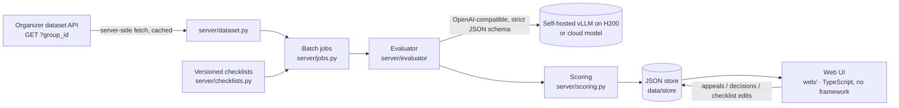

# CQA — Conversation Quality Analytics (Freedom Broker, Data Challenge 2026)

A prototype that scores contact-center operator **chats and calls** (RU / KZ / EN) against a configurable checklist with an LLM judge.

For every criterion it shows:
- the verdict and points;
- an explanation in Russian;
- the evidence turns: a click jumps to the message, and for calls the player seeks to that fragment;
- the turns where a missed action was expected;
- the N/A reason.

The total is weighted, and the weight of N/A criteria is redistributed. Gross errors are flagged separately. Operators file appeals, and a reviewer confirms or changes the verdict; the card keeps the original, the decision and the final result. Checklists are named and versioned, and editing one and re-applying it takes one click.



## Quick start

You need Python 3.14 and Node 20+.

```bash
python -m venv .venv && .venv/Scripts/activate        # Linux/macOS: source .venv/bin/activate
pip install -e ".[dev]"
npm ci --prefix web && npm run build --prefix web     # compiles web/src → web/dist
cp .env.example .env                                   # then fill in the values below
uvicorn server.app:app --port 8787                     # open http://localhost:8787
```

### `.env`

| Variable | Meaning |
|---|---|
| `DATASET_URL` | The organizers' GET URL for the dataset ("Открыть GET для DEV" in the guide). The server swaps in the `group_id` it needs. The URL is signed, so never commit it. |
| `LLM_PROFILE` | Default model profile from `config/profiles.toml`. `fake` runs offline and deterministically, for demos without a GPU. |
| `EVAL_MODE` / `EVAL_K` | `single` makes one call for all criteria; `per_criterion` makes one call per criterion. `K` is the number of samples for majority voting. |
| `H200_*` | Base URLs and the key of the self-hosted vLLM endpoints. |
| `AIGW_*` | Optional: an OpenAI-compatible gateway for cloud models (Claude, GPT, AlemLLM). |

All outbound HTTP uses `server/http.py`. It trusts both the OS certificate store and certifi, because some networks fail with only one of them.

## Using it

| Screen | What you do |
|---|---|
| **Диалоги** (`#/dialogs/DEV`) | Load a dataset group, filter by channel / language / gross errors, select dialogs, pick a checklist (by default chosen by channel), and click **Оценить выбранные**. Progress and per-dialog errors are shown live. |
| **Карточка оценки** | The transcript, with the audio player for calls, next to the criteria table. Click `[idx]` to jump to the turn, or the call position. Also shows the total, section totals, the gross-error badge, model/mode, the raw model calls («Вызовы модели») and the history by checklist version. **Переоценить по текущему чек-листу** re-applies an edited checklist. **Оспорить** files an appeal. |
| **Проверка апелляций** (`#/review`) | The queue of open appeals, with the disputed verdict, the comment and the dialog fragment. **Подтвердить** or **Изменить** (the reason is required) recomputes the final total. |
| **Чек-листы** (`#/checklists`) | Create or edit checklists: criteria, wording, weight, answer type (yes/no or scale with steps), N/A on or off and its condition, sections, and gross-error criteria. Every save creates a new version, and old evaluations keep the version they were scored with. |

The default checklists are in `data/checklists/`:
- `chat.default.json`: the organizers' 8 criteria, verbatim from `docs/CQA_Chat_Quality_Checklist.pdf`.
- `call.default.json`: the same criteria adapted to speech, following the organizers' clarification #2343 (see `docs/organizer-answers.md`).

Organizer clarifications and the team's rules for borderline cases are in each checklist's `notes`, which the model reads.

### Batch run (control set)

```bash
python scripts/run_batch.py <GROUP_ID> --refresh     # fetches the group, evaluates every dialog with the defaults
```

This prints a table and the token, time and cost totals. It writes `out/<GROUP_ID>.results.json` and `.csv` with the per-criterion verdicts, and stores the evaluations so they appear in the UI. The control-set results are raw system output, with no manual edits.

## How the evaluation works

1. **Prompt.** The prompt is generic and in Russian, so no criterion text is hard-coded. It carries:
   - each criterion's wording, its allowed verdicts and the step descriptions;
   - the N/A condition;
   - the checklist notes (calculation rules, organizer clarifications, team rules).

   The transcript goes in as `[idx] (timestamp) speaker: text`. Only `operator` turns are judged; `bot` and `system` turns are context.
2. **Strict JSON schema.** On vLLM this is xgrammar `json_schema`; for gateway models that ignore `response_format`, the schema goes into the prompt. The model writes `explanation` and `evidence_idx` **before** `verdict`.
3. **Validation.** Verdicts must be allowed for the criterion (for example, no N/A where it is not allowed). Turn indices must be in range. A «Да» or a step needs evidence; a «Нет» needs evidence or the range where the action was expected; N/A needs a reason.
4. **Retry.** Invalid criteria are retried once, alone, with the error text. If only the evidence is still missing, the verdict is kept with a warning (⚠ in the UI), so one soft criterion cannot drop the whole dialog.
5. **Optional voting.** With k samples, yes/no/N/A take the mode and scales take the median. The vote counts are shown.
6. **Scoring.** `server/scoring.py` uses `Decimal`:
   - «Да» gives the full weight; a scale step gives `step/max_step × weight`;
   - N/A criteria are excluded and their weight is redistributed;
   - the total is out of 100, rounded half-up to 2 decimals, and is empty when no weighted criterion applies;
   - gross errors are flagged and do not change the total.
7. **Audit.** Every model call (messages, response, model, timing) is stored with the evaluation and shown in the UI under «Вызовы модели». That is the proof that results are computed, not replayed.

## Models and cost

Models are named profiles in `config/profiles.toml`.

| Profile | Model | Where |
|---|---|---|
| `h200-gemma` | Gemma 4 31B | self-hosted vLLM, 1× H200 |
| `h200-gptoss` | gpt-oss-120b (reasoning low) | self-hosted vLLM, 1× H200 |
| `h200-kz` | ISSAI Qwen3.5-35B-A3B-Kazakh | self-hosted vLLM, 1× H200 |
| `h200-glimmer` | Muse-Glimmer-30B | self-hosted vLLM, 1× H200 |
| `aigw-sonnet` / `aigw-luna` / `aigw-alemllm` | Claude Sonnet 5.5 / GPT-6 Luna / AlemLLM | cloud, via gateway |

The model is chosen by benchmark against hand-labelled DEV dialogs (`bench/`, `docs/research/benchmark-phase1.md`). We prefer a self-hosted model unless a cloud model is more than 5 pp better.

**Cost of one evaluation** (all calls included, single mode):
- **Self-hosted:** an H200 costs $5.35/GPU-hour (median on-demand price of Vast, RunPod, Nebius and CoreWeave, 2026-11; see `docs/research/llm-candidates.md`). The cost per evaluation is `$/h × GPU-seconds ÷ concurrency ÷ 3600`, which is **≈ $0.001**.
- **Cloud:** Claude Sonnet 5.5 at $2 / $10 per 1M tokens is **≈ $0.024**. GPT-6 Luna at $0.10 / $0.50 is **≈ $0.001**.

Measured on the 12-dialog smoke set, about 7k input and 0.5–1k output tokens per dialog.

## Benchmark and gold labels

```bash
python -m bench.run --profiles h200-gemma,aigw-sonnet --mode single --k 1 --set smoke|gold
python -m bench.select_gold --seed 7      # 24 DEV dialogs → 8 per labeller
python -m bench.prefill                   # pre-fill bench/gold/labels.<login>.csv with model verdicts
```

A run writes JSONL rows and a `summary.md` under `bench/results/<timestamp>/`. The summary reports:
- validity and failure rates, latency and cost;
- on `--set gold`: weighted per-criterion agreement, total MAE and bias, kappa, the N/A confusion matrix, gross-error precision and recall, and agreement by language and channel.

## Development

```bash
pytest -q                                  # all tests (offline; the fake profile, no network)
python scripts/gen_types.py                # pydantic models → contracts/schema.json → web/src/types.gen.ts
npm run typecheck --prefix web
LLM_PROFILE=fake uvicorn server.app:app --port 8787   # full app offline: deterministic fake model, no GPU or network
```

CI (`.github/workflows/ci.yml`) runs pytest, regenerates the types and fails if they are stale, and type-checks the web code. The plan and the decisions behind it are in `docs/superpowers/plans/2026-11-07-cqa-prototype.md`, terms in `GLOSSARY.md`, and team and agent conventions in `AGENTS.md`.

The web UI is plain TypeScript ES modules with no framework and no bundler. Styles are scoped under `.cqa`, and the entry point is `mountCqa(root, {apiBase})`, so it can be embedded as a Dynamics 365 HTML web resource.
