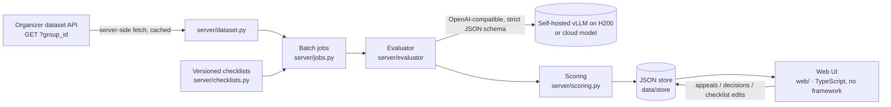

# CQA — Conversation Quality Analytics (Freedom Broker, Data Challenge 2026)

A prototype that scores contact-center operator **chats and calls** (RU / KZ / EN) against a configurable checklist with an LLM judge.

For every criterion it shows:
- the verdict and points;
- an explanation in Russian;
- the evidence turns: a click jumps to the message, and for calls the player seeks to that fragment;
- the turns where a missed action was expected;
- the N/A reason.

The total is weighted, and the weight of N/A criteria is redistributed. Gross errors are flagged separately. Operators file appeals, and a reviewer confirms or changes the verdict; the card keeps the original, the decision and the final result. Checklists are named and versioned, and editing one and re-applying it takes one click.



## Quick start

You need Python 3.14 and Node 20+.

```bash
python -m venv .venv && .venv/Scripts/activate        # Linux/macOS: source .venv/bin/activate
pip install -e ".[dev]"
npm ci --prefix web && npm run build --prefix web     # compiles web/src → web/dist
cp .env.example .env                                   # then fill in the values below
uvicorn server.app:app --port 8787                     # open http://localhost:8787
```

### `.env`

| Variable | Meaning |
|---|---|
| `DATASET_URL` | The organizers' GET URL for the dataset ("Открыть GET для DEV" in the guide). The server swaps in the `group_id` it needs. The URL is signed, so never commit it. |
| `LLM_PROFILE` | Default model profile from `config/profiles.toml`. `fake` runs offline and deterministically, for demos without a GPU. |
| `EVAL_MODE` / `EVAL_K` | `single` makes one call for all criteria; `per_criterion` makes one call per criterion. `K` is the number of samples for majority voting. |
| `H200_*` | Base URLs and the key of the self-hosted vLLM endpoints. |
| `AIGW_*` | Optional: an OpenAI-compatible gateway for cloud models (Claude, GPT, AlemLLM). |

All outbound HTTP uses `server/http.py`. It trusts both the OS certificate store and certifi, because some networks fail with only one of them.

## Using it

The interface follows the Freedom Broker visual language: a light shell (page `#F5F6F7`, white cards with a 1px border), the green accent `#007A43`, the Freedom Broker | CQA logo and the Onest typeface embedded in the CSS as a 45 KB subset (Cyrillic with the Kazakh letters, no font files and no CDN). The brand gradient appears only on the one primary button of a screen, always with dark text. Colour pairs are contrast-checked against WCAG 2.2 AA. On screens up to 860 px wide the sidebar becomes a top bar with four labelled items, tables scroll inside their own region, and the page itself never scrolls sideways. A skip link and visible focus work on every screen, and `prefers-reduced-motion` turns off smooth scrolling and the evidence flash.

| Screen | What you do |
|---|---|
| **Диалоги** (`#/dialogs/DEV`) | Load a dataset group, filter by channel / language / gross errors, select dialogs, pick a checklist (by default chosen by channel), and click **Оценить выбранные**. Mode and k are under «Параметры оценки». Progress and per-dialog errors are shown live. A scored dialog opens its latest result. On a phone each row is a card with the ID, the total and the gross-error badge. |
| **Анализ разговора** (result card) | The score ring and per-criterion points come first, then «Почему снижена оценка»; the transcript sits beside them on a wide screen and below them on a narrow one. The audio player for calls is a native `<audio>`, and turns are numbered from 1. «Почему снижена оценка» lists every criterion that lost points with its full reason, **Перейти к фрагменту** (scrolls to the turn; for calls, seeks the audio) and **Оспорить оценку** (files an appeal). «Подробности оценки» holds the full criteria table, votes, warnings, model/mode, the raw model calls and the history by checklist version. **Переоценить по текущему чек-листу** re-applies an edited checklist. |
| **Апелляции** (`#/review`) | The queue of open appeals: the criterion, the disputed verdict, the model's reason, the operator's comment and the dialog fragment, then the decision. **Подтвердить** or **Изменить** (the reason is required) recomputes the final total; the card shows the new total and a link back to the dialog, and the result card shows the original → decision → final chain. |
| **Чек-листы** (`#/checklists`) | Create or edit checklists: criteria, wording, weight, answer type (yes/no or scale with steps), N/A on or off and its condition, sections, and gross-error criteria. Every save creates a new version (the button locks while a save is running), and old evaluations keep the version they were scored with. |
| **Аналитика** (`#/analytics/DEV`) | Per group: dialogs evaluated, mean total, gross errors as real links, N/A share, the pass rate per criterion, breakdowns by channel and language, and the score distribution with its four ranges labelled. |


More screenshots are in `docs/screenshots/` (`dialogs`, `review`, `checklists`, `checklist-editor`, `analytics`, `facts`). They show the committed gemma-4 DEV output (`results/dev/results.json`) loaded into a scratch store; the `review` image has one appeal added on that scratch copy. Before and after images of all seven screens at 1440 and 390 px, taken from the same data, are in `docs/redesign/before/` and `docs/redesign/after/`. A 5-minute demo script is in `docs/demo.md`.

The call card also has a presentational block for audio upload and a choice of two ASR providers (`web/src/ui/callPanel.ts`). It is not rendered yet, because the server has no ASR routes; see issue #39.

The default checklists are in `data/checklists/`:
- `chat.default.json`: the organizers' 8 criteria, verbatim from `docs/CQA_Chat_Quality_Checklist.pdf`.
- `call.default.json`: the same criteria adapted to speech, following the organizers' clarification #2343 (see `docs/organizer-answers.md`).

Organizer clarifications and the team's rules for borderline cases are in each checklist's `notes`, which the model reads.

### Batch run and submission files

```bash
python scripts/run_batch.py DEV --refresh --submit dev                # → results/dev/results.json
python scripts/run_batch.py <CONTROL_GROUP> --refresh --submit prod   # → results/prod/results.json (10 control chats)
```

This prints a table and the token, time and cost totals. It writes `out/<GROUP_ID>.results.json` and `.csv` with the per-criterion verdicts and the profile used per dialog, and stores the evaluations so they appear in the UI. The control-set results are raw system output, with no manual edits.

`--submit dev|prod` also writes the organizers' file in the appendix format 1.0 (`server/submission.py`) and validates it. The rules it follows:
- criterion codes `contact … critical`, with `true`/`false`/`null` or raw scale points;
- `evidence_turns` numbered from 1 over the raw transcript;
- a failed dialog becomes a `status: "error"` entry;
- `model.mode` is `local`, or `hybrid` if the cloud fallback scored any dialog.

`team_name` comes from `--team-name` or env `TEAM_NAME`. Commit and push both files before stop-code.

A dialog that fails on the primary profile (for example, the self-hosted endpoint is unreachable) is re-run on each profile in `--fallback-profile`, in order. The chain lives in the job runner, so live evaluations from the UI fall back the same way. That is a comma-separated list, defaulting to env `FALLBACK_PROFILE` (`aigw-sonnet,aigw-luna,h200-glimmer`). The two cloud models come first; the last one is self-hosted, so neither a gateway outage nor a rate limit leaves dialogs unscored. Costs are reported per profile.

`--submit` scores with the organizers' checklist. If the default `chat`/`call` checklist was edited in the UI (for example, during a demo), the run aborts before evaluating. Re-run it with `--reset-defaults`, which saves `data/checklists/*.default.json` back as a new version and keeps the history.

Before the control run, `python scripts/preflight.py [--group <CONTROL_GROUP>]` checks everything the run needs in about 30 s:
- the `.env` keys;
- git: on `main`, clean, in sync with `origin`;
- the default checklists;
- the dataset API (DEV, plus the control group, which must return 10 records);
- one real completion from the primary model and from each fallback.

## How the evaluation works

1. **Prompt.** The prompt is generic and in Russian, so no criterion text is hard-coded. It carries:
   - each criterion's wording, its allowed verdicts and the step descriptions;
   - the N/A condition;
   - the checklist notes (calculation rules, organizer clarifications, team rules).

   The transcript goes in as `[idx] (timestamp) speaker: text`. Only `operator` turns are judged; `bot` and `system` turns are context.
2. **Strict JSON schema.** On vLLM this is xgrammar `json_schema`; for gateway models that ignore `response_format`, the schema goes into the prompt. The model writes `explanation` and `evidence_idx` **before** `verdict`.
3. **Validation.** Verdicts must be allowed for the criterion (for example, no N/A where it is not allowed). Turn indices must be in range. A «Да» or a step needs evidence; a «Нет» needs evidence or the range where the action was expected; N/A needs a reason.
4. **Retry.** Invalid criteria are retried once, alone, with the error text. If only the evidence is still missing, the verdict is kept with a warning (⚠ in the UI), so one soft criterion cannot drop the whole dialog.
5. **Optional voting.** With k samples, yes/no/N/A take the mode and scales take the median. The vote counts are shown.
6. **Scoring.** `server/scoring.py` uses `Decimal`:
   - «Да» gives the full weight; a scale step gives `step/max_step × weight`;
   - N/A criteria are excluded and their weight is redistributed;
   - the total is out of 100, rounded half-up to 2 decimals, and is empty when no weighted criterion applies;
   - gross errors are flagged and do not change the total.
7. **Audit.** Every model call (messages, response, model, timing) is stored with the evaluation and shown in the UI under «Вызовы модели». That is the proof that results are computed, not replayed.

## Models and cost

Models are named profiles in `config/profiles.toml`.

| Profile | Model | Where |
|---|---|---|
| `h200-gemma` | Gemma 4 31B | self-hosted vLLM, 4 replicas × 1 H200 |
| `h200-kz` | ISSAI Qwen3.5-35B-A3B-Kazakh | self-hosted vLLM, 1× H200 |
| `h200-glimmer` | Muse-Glimmer-30B | self-hosted vLLM, 1× H200 |
| `aigw-sonnet` / `aigw-luna` / `aigw-alemllm` | Claude Sonnet 5.5 / GPT-6 Luna / AlemLLM | cloud, via gateway |
| `alem-deepseek` / `alem-kimi` / `alem-glm` / `alem-qwen27b` / `aigw-flashnext` | DeepSeek-V4.1-Flash / Kimi-K2.6 / GLM-5.3 / Qwen3.8-27B / Qwen3.8-Flash-Next | open weights on Alem.Cloud, via gateway |
| `ensemble` | per-criterion vote of `h200-gemma` (per criterion) + `alem-qwen27b` + `aigw-flashnext` (single) | hybrid |

An `ensemble` profile (`provider = "ensemble"`, `members = ["profile:mode", …]`) runs every member on the dialog and takes, per criterion, the majority verdict; on scales it takes the median. The first member breaks ties and supplies the explanation and evidence when it agrees. A member that fails is dropped with a warning on the items; the dialog fails only if all members fail.

The model is chosen by benchmark against labelled DEV dialogs (`bench/`, `docs/research/benchmark-phase1.md`). The gold is an **LLM consensus**: 4 blind labelings per dialog by GPT-6 Astra and Claude Opus 5.5. On top of it sit **20 human rows** (`bench/gold/labels.Batyrkhantzy111.arbitration.csv`), which settle the disputed verdicts and override the consensus. `--gold human` ranks models on the human rows only. We prefer a self-hosted model unless a cloud model is more than 5 pp better.

**Current default for the control run:** `h200-gemma`, `per_criterion` (one call per criterion), `k=1`, temperature 0, with the fallback chain `aigw-sonnet,aigw-luna,h200-glimmer`. With the current notes it scores **0.931–0.939 weighted agreement** on the 60 chats and matches 16 of the 20 human rows. 99.6% of its verdicts are identical between runs. It was compared against about 15 other models and setups:
- open-weight models: Qwen3.8-27B 0.92, Qwen3.8-Flash-Next 0.91, DeepSeek-V4.1-Flash 0.90, Kimi-K2.6 0.85;
- frontier models via OpenRouter (Gemini 4 Argon, Gemini 3.8 Flash, Grok 4.7, DeepSeek-V4-Pro): each scored 1–2 pp below gemma on the same dialogs;
- a three-judge ensemble, which tied gemma.

These numbers are in-sample: the same dialogs were used to tune the checklist notes, and the agreement is with other models' labels plus 20 human rows, not with the organizers' expert labels. Expect roughly **0.91–0.93 on unseen chats**. The details are in `docs/research/benchmark-phase1.md`.

**Cost of one evaluation** (all calls included):
- **Self-hosted:** an H200 costs $5.35/GPU-hour (median on-demand price of Vast, RunPod, Nebius and CoreWeave, 2026-11; see `docs/research/llm-candidates.md`). The cost per evaluation is `$/h × GPU-seconds ÷ concurrency ÷ 3600`.
  - **Single mode:** ≈ $0.001.
  - **Per-criterion mode:** ≈ $0.003. The full DEV run (65 dialogs) cost $0.18 and took 8.5 minutes of wall time at 4 dialogs in parallel.
- **Cloud:** in single mode, Claude Sonnet 5.5 at $2 / $10 per 1M tokens is **≈ $0.024** and GPT-6 Luna at $0.10 / $0.50 is **≈ $0.001**. Sonnet in per-criterion mode is ≈ $0.07.

Single-mode figures were measured on the 12-dialog smoke set (about 7k input and 0.5–1k output tokens per dialog). Per-criterion figures come from the full DEV run (about 21k input tokens per dialog).

**Reproducibility.** Two independent DEV runs with the control settings agreed on 507 of 512 criterion verdicts (99.0%), across 64 dialogs.
- 59 dialogs were identical, and no gross-error flag changed.
- The mean change in total was 0.73 points.
- The 5 changes were borderline calls: c06 7↔10 and 4↔7, and one N/A↔«Нет» each on c02 and c03.

## Benchmark and gold labels

```bash
python -m bench.run --profiles h200-gemma,aigw-sonnet --mode single --k 1 --set smoke|gold [--gold human]
python -m bench.select_gold --seed 7      # 24 DEV dialogs → 8 per labeller
python -m bench.prefill                   # pre-fill bench/gold/labels.<login>.csv with model verdicts
```

A run writes JSONL rows and a `summary.md` under `bench/results/<timestamp>/`. The summary reports:
- validity and failure rates, latency and cost;
- on `--set gold`: weighted per-criterion agreement, total MAE and bias, kappa, the N/A confusion matrix, gross-error precision and recall, and agreement by language and channel.

## Development

```bash
pytest -q                                  # all tests (offline; the fake profile, no network)
python scripts/gen_types.py                # pydantic models → contracts/schema.json → web/src/types.gen.ts
npm run typecheck --prefix web
LLM_PROFILE=fake uvicorn server.app:app --port 8787   # full app offline: deterministic fake model, no GPU or network
```

CI (`.github/workflows/ci.yml`) runs pytest, regenerates the types and fails if they are stale, and type-checks the web code. The plan and the decisions behind it are in `docs/superpowers/plans/2026-11-07-cqa-prototype.md`, terms in `GLOSSARY.md`, and team and agent conventions in `AGENTS.md`.

The web UI is plain TypeScript ES modules with no framework and no bundler. Styles are scoped under `.cqa`, and the entry point is `mountCqa(root, {apiBase})`. The D365 loader, resource packager and opt-in CORS are included. Deployment conditions and local checks are documented in `docs/research/d365-web-resources.md`.

## Встраивание в Dynamics 365

Сборка: `web/node_modules/.bin/tsc -p web`, затем `python scripts/package_d365.py`.
Загрузите все файлы из `out/d365/cqa_/` как web resources с теми же именами: `cqa_/index.htm`, `cqa_/loader.js`, `cqa_/cqa.css`, `cqa_/dist/**/*.js`, `cqa_/assets/*.svg`.
В параметре `data` контрола задайте JSON, например `{"apiBase":"https://cqa.example.com/api","route":"#/dialogs/DEV"}`.
На API укажите `CQA_ALLOWED_ORIGINS=https://example.crm.dynamics.com`; несколько origin разделяются запятой, пустое значение выключает CORS.
В настройках контрола «Restrict cross-frame scripting» должно быть OFF, «Pass record object-type code and unique identifier» должно быть ON.
Пакет готов к загрузке как HTML web resource, проверено на локальном стенде, условия перечислены в [отчёте D365](docs/research/d365-web-resources.md). Проверка в организации D365 и HTTPS для API ещё нужны.
