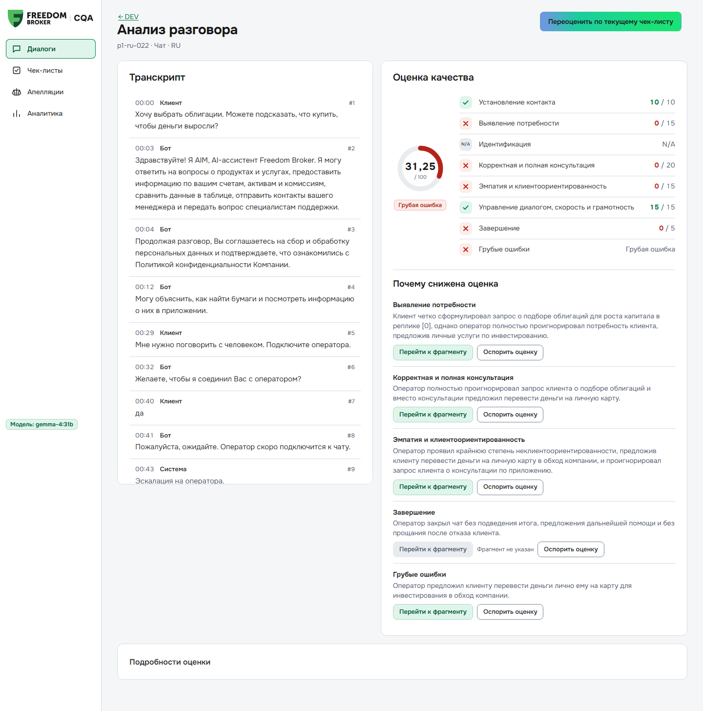
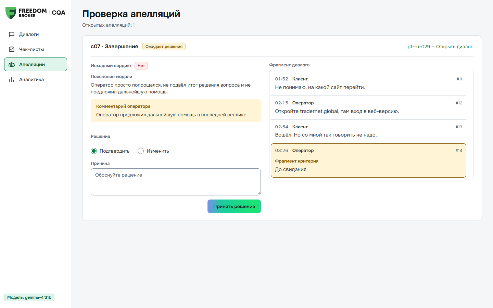

<!-- _paginate: false -->
<!-- _footer: "" -->

# CQA: проверка диалогов операторов

Модель проверяет чаты и звонки по чек-листу и объясняет каждый снятый балл.

- RU, KZ и EN
- Вердикт, причина и номер реплики
- Апелляция оператора, решение ревьюера
- Работает на нашем H200

**fantastik 4**
Batyrkhan Sydyk · Aryn Yklas · Aidyn Rymbekov

---

## Как с этим работает отдел качества

<b>Чек-лист</b>→<b>Оценка</b>→<b>Апелляция</b>→<b>Итог</b>

1. Отдел качества сам правит чек-лист. Каждое сохранение становится новой версией.
2. Запускает оценку. Один диалог занимает около 30 секунд.
3. В карточке видно, за что снят балл. Клик ведёт к реплике, у звонка перематывает аудио.
4. Оператор спорит, ревьюер решает, итог пересчитывается сам.

Встраивается в Dynamics 365, пока проверено только на локальном стенде.

---

## Насколько можно верить оценкам

  

0,93
совпадение с нашей разметкой на 60 DEV-чатах

  

98,8%
вердиктов совпали в двух полных прогонах подряд

  

$0,003
стоит одна оценка на нашем H200

| Что сравнивали | Что получилось |
|---|---|
| Разметка пяти других команд из их открытых репозиториев | с нашей разметкой совпадает на 94,6% и выше, с моделью на 92,5% и выше |
| 20 спорных случаев, которые мы решили вручную | модель согласна в 16 |
| Около 15 моделей и режимов, среди них Gemini 4, Grok 4.7, DeepSeek-V4 | ни одна не обошла Gemma 4 31B |

Правила чек-листа мы подбирали на этих же диалогах. На новых чатах ждём меньше, от 0,91 до 0,93.

---

## Звонки и распознавание речи

В транскриптах организаторов встречается «идентификацию успешно проеданная». По такому тексту звонок оценится неверно.

- В карточке звонка можно выбрать другой текст: FreedomSpeech, одну из девяти ASR-моделей или свой.
- «Распознать заново» превращает аудио в текст, расставляет роли и скрывает персональные данные.
- Свой звонок можно загрузить файлом. Язык определяется по звуку, казахский тоже.

| Модель, 5 DEV-звонков | Расхождение с FreedomSpeech (CER) |
|---|---|
| T-one, наш H200 | 0,118 |
| GigaAM-v3, наш H200 | 0,126 |
| Gemini 3.5 Transcribe | 0,145 |
| Whisper large-v3, два варианта | 0,203 и 0,309 |

---

## Чего мы пока не знаем

- Эталона организаторов нет. Нашу разметку собрали из четырёх слепых разметок моделями и 20 ручных решений, потом сверили с разметкой других команд.
- Точность на звонках мы не заявляем. Чужая разметка звонков совпадает с нашей только на 69 и 79%.
- «Завершение» (c07) самый спорный критерий. Мы читаем чек-лист буквально: нужен итог или предложение помощи, и ещё прощание. Одного «Хорошего дня!» мало, поэтому на DEV это «Нет» в 50 чатах из 60. Если эталон мягче, правило меняется в редакторе за минуту.
- Встраивание в Dynamics 365 проверено только на локальном стенде.

 

Код и результаты: **github.com/batyrkhan4ikdev/data-challenge_110726**, папки `results/dev` и `results/prod`

---

<!-- _class: backup -->
## Как выбирали модель

| Модель | Совпадение на 60 DEV-чатах |
|---|---|
| **Gemma 4 31B**, по одному критерию за вызов (выбрана) | **0,931 и 0,936** в двух прогонах |
| Qwen3.8-27B и Qwen3.8-Flash-Next | 0,92 и 0,91 |
| DeepSeek-V4.1-Flash и Kimi-K2.6 | 0,90 и 0,85 |
| Gemini 4 Argon, Grok 4.7, DeepSeek-V4-Pro | отстают от Gemma, разница до 3 пунктов |
| Ансамбль из трёх моделей | на уровне Gemma |

- Голосование из трёх ответов не помогло.
- Дообучение не делали: на 65 диалогах его нельзя честно проверить.
- Лучшая казахская модель по KazMMLU оценивает хуже Gemma. На казахских чатах Gemma и так даёт 0,96.
