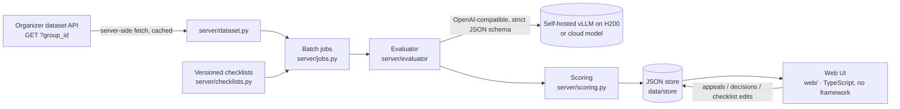
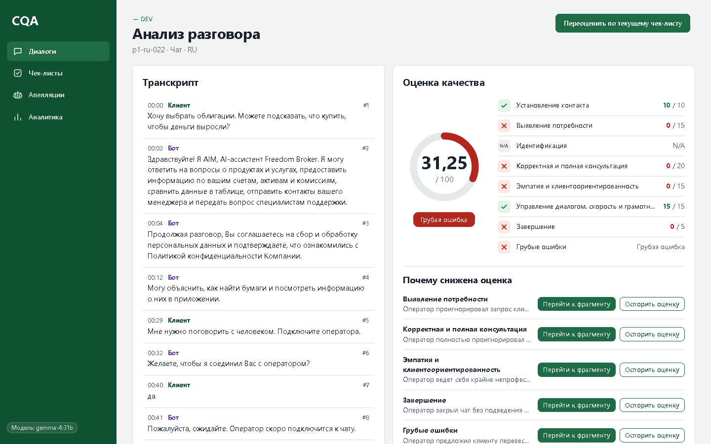

# CQA: техническая справка

Полная техническая справка: настройка, пакетный прогон и файлы для сдачи, устройство оценки, модели и стоимость, бенчмарк, ASR, D365, Docker. Обзор — в [README](../README.md). Пути ниже указаны от корня репозитория.

Прототип, который оценивает **чаты и звонки** операторов контакт-центра (RU / KZ / EN) по настраиваемому чек-листу с помощью LLM-судьи.

По каждому критерию он показывает:
- вердикт и баллы;
- объяснение на русском;
- реплики-доказательства: клик переходит к сообщению, а для звонков плеер перематывается к нужному фрагменту;
- реплики, где ожидалось пропущенное действие;
- причину N/A.

Итог взвешенный, вес критериев N/A перераспределяется. Грубые ошибки отмечаются отдельно. Операторы подают апелляции, ревьюер подтверждает или меняет вердикт; в карточке сохраняются исходная оценка, решение и итоговый результат. Чек-листы именованные и версионируются; правка и повторное применение — один клик.



## Быстрый старт

Нужны Python 3.14 и Node 24 (версии, которые используют CI и Dockerfile).

```bash
python -m venv .venv && .venv/Scripts/activate        # Linux/macOS: source .venv/bin/activate
pip install -e ".[dev]"
npm ci --prefix web && npm run build --prefix web     # compiles web/src → web/dist
cp .env.example .env                                   # then fill in the values below
uvicorn server.app:app --port 8787                     # open http://localhost:8787
```

### `.env`

| Переменная | Назначение |
|---|---|
| `DATASET_URL` | GET-адрес датасета от организаторов («Открыть GET для DEV» в руководстве). Сервер подставляет нужный `group_id`. Адрес подписан, поэтому никогда не коммитьте его. |
| `LLM_PROFILE` | Профиль модели по умолчанию из `config/profiles.toml`. `fake` работает офлайн и детерминированно, для демо без GPU. |
| `EVAL_MODE` / `EVAL_K` | `single` делает один вызов на все критерии; `per_criterion` — один вызов на критерий. `K` — число сэмплов для голосования большинством. |
| `H200_*` | Базовые URL и ключ собственных эндпоинтов vLLM. |
| `AIGW_*` | Опционально: OpenAI-совместимый эндпоинт для облачных API-моделей (Claude, GPT, AlemLLM). |

Весь исходящий HTTP идёт через `server/http.py`. Он доверяет и хранилищу сертификатов ОС, и certifi, потому что в некоторых сетях работает только одно из них.

## Как пользоваться

Интерфейс следует визуальному языку Freedom Broker: светлая оболочка (страница `#F5F6F7`, белые карточки с рамкой 1px), зелёный акцент `#007A43`, логотип Freedom Broker | CQA и шрифт Onest, встроенный в CSS как подмножество на 45 КБ (кириллица с казахскими буквами, без файлов шрифтов и без CDN). Фирменный градиент есть только на одной главной кнопке экрана, всегда с тёмным текстом. Цветовые пары проверены на контраст по WCAG 2.2 AA. На экранах шириной до 860 px боковая панель превращается в верхнюю с четырьмя подписанными пунктами, таблицы прокручиваются внутри своей области, а сама страница никогда не прокручивается вбок. Ссылка пропуска навигации и видимый фокус работают на каждом экране, а `prefers-reduced-motion` отключает плавную прокрутку и подсветку доказательств.

| Экран | Что делаете |
|---|---|
| **Диалоги** (`#/dialogs/DEV`) | Загружаете группу датасета, фильтруете по каналу / языку / грубым ошибкам, выбираете диалоги, выбираете чек-лист (по умолчанию подбирается по каналу) и нажимаете **Оценить выбранные**. Режим и k — в «Параметры оценки». Прогресс и ошибки по диалогам показываются вживую. Оценённый диалог открывается на последнем результате. «Порядок: требует внимания» сортирует по приоритету проверки (грубая ошибка, открытые апелляции, предупреждения, N/A, критерии, по которым судья часто расходится, вердикты, противоречащие фактам диалога); причины — во всплывающей подсказке чипа, и это приоритет, а не вероятность ошибки. На телефоне каждая строка — карточка с ID, итогом и значком грубой ошибки. |
| **Загрузить звонок или чат** (на «Диалоги») | Добавляет новый диалог в группу `UPLOADS`: аудиофайл (mp3/wav/ogg/m4a/webm/flac, до 50 МБ, при необходимости конвертируется в MP3 через ffmpeg) проходит ASR, определение ролей говорящих и маскирование; вставленный чат (строки `оператор:` / `клиент:` / `бот:`) принимается как есть. Язык по умолчанию определяется по аудио (казахское аудио перезапускается как `kk`). Загруженные диалоги дальше проходят тот же цикл: оценка, результат, апелляция, переоценка, аналитика. Записи и аудио остаются в `data/store/uploads/` (в gitignore). API: `POST /api/uploads/call` (multipart), `POST /api/uploads/chat`, `GET /api/uploads/{id}/audio`, `DELETE /api/uploads/{id}`. |
| **Анализ разговора** (карточка результата) | Сначала кольцо итога и баллы по критериям, затем «Почему снижена оценка»; транскрипт стоит рядом на широком экране и ниже на узком. Аудиоплеер для звонков — нативный `<audio>`, реплики нумеруются с 1. «Почему снижена оценка» перечисляет каждый критерий, потерявший баллы, с полной причиной, **Перейти к фрагменту** (прокручивает к реплике; для звонков перематывает аудио) и **Оспорить оценку** (подаёт апелляцию). «Подробности оценки» содержит полную таблицу критериев (каждый критерий с измеренным совпадением с разметкой DEV и «часто спорный» ниже 85%), голоса, предупреждения, модель/режим, сырые вызовы модели, историю по версиям чек-листа и **Сравнение оценок**: любые две оценки рядом, раскрыты только изменённые критерии. **Переоценить по текущему чек-листу** заново применяет отредактированный чек-лист. **Выгрузить дело** скачивает ZIP с транскриптом, оценкой, точной версией чек-листа, апелляциями, итоговым результатом и сырыми вызовами модели, с хешами SHA-256 и самопроверкой пересчитанного итога (`scripts/verify_regpack.py <zip>` повторяет её офлайн). «Подтверждения проверяющего» принимает неоспоренные критерии одним пакетом (с автоматически созданной строкой «принято пакетом без раскрытия доказательств») или по одному; подтверждения хранятся отдельно от апелляций и никогда не меняют итог. Панель фактов добавляет дорожку «Бот / оператор»: что клиент сказал боту до передачи и спросил ли оператор повторно. |
| **Как было бы правильно** (карточка результата, по каждому потерянному критерию) | Для критерия, потерявшего баллы, судья предлагает минимальную правку не более чем в 2 репликах оператора, и отредактированный диалог оценивается заново только по этому критерию; карточка показывает правку, обоснование и подтверждён ли новый вердикт. Это только разбор: он никогда не сохраняется как оценка, итоги и апелляции не затрагиваются. Для критерия грубой ошибки не предлагается. API: `POST /api/evaluations/{id}/recourse`. |
| **Апелляции** (`#/review`) | Очередь открытых апелляций: критерий, оспариваемый вердикт, причина модели, комментарий оператора и фрагмент диалога, затем решение. **Подтвердить** или **Изменить** (причина обязательна) пересчитывает итоговый балл; карточка показывает новый итог и ссылку обратно на диалог, а карточка результата — цепочку исходная оценка → решение → итог. Клавиатура: `j`/`k` — следующая/предыдущая карточка, `a` — принять неоспоренные, `o` — открыть форму решения. |
| **Чек-листы** (`#/checklists`) | Создание и правка чек-листов: критерии, формулировки, вес, тип ответа (да/нет или шкала с шагами), N/A вкл/выкл и его условие, разделы и критерии грубых ошибок. Каждое сохранение создаёт новую версию (кнопка блокируется на время сохранения), а старые оценки сохраняют версию, по которой были оценены. |
| **Аналитика** (`#/analytics/DEV`) | По группе: оценено диалогов, средний итог, грубые ошибки как настоящие ссылки, доля N/A, доля прохождения по каждому критерию, разрезы по каналу и языку, а также распределение итогов с четырьмя подписанными диапазонами. «Дрейф оценок» сравнивает распределение баллов с базовой группой (или с первой половиной оценок группы): PSI с обычными порогами 0.1 / 0.25 для итога и для каждого критерия, плюс двухвыборочный критерий KS только для итога; при n < 30 сообщает, что выборка слишком мала для выводов. |



Другие скриншоты лежат в `docs/screenshots/` (`dialogs`, `review`, `checklists`, `checklist-editor`, `analytics`, `facts`, `transcripts`). Они показывают закоммиченный результат gemma-4 на DEV (`results/dev/results.json`), загруженный во временное хранилище; на скриншоте `review` в эту временную копию добавлена одна апелляция. Сценарий живой демонстрации — в `docs/demo.md`.

Переключатель «Транскрипт» в карточке звонка (`web/src/ui/transcriptPanel.ts`, см. «Транскрипты звонков и ASR» ниже) выбирает транскрипт, по которому оценивается звонок. Варианты: транскрипт из API организаторов, FreedomSpeech, наши ASR-модели с бейджами качества и вставленный транскрипт. «Распознать заново» запускает провайдера вживую.

Чек-листы по умолчанию лежат в `data/checklists/`:
- `chat.default.json`: 8 критериев организаторов дословно из `docs/CQA_Chat_Quality_Checklist.md`.
- `call.default.json`: те же критерии, адаптированные к речи по разъяснению организаторов #2343 (см. `docs/internal/organizer-answers.md`).

Разъяснения организаторов и правила команды для спорных случаев находятся в `notes` каждого чек-листа, которые читает модель.

### Пакетный прогон и файлы для сдачи

```bash
python scripts/run_batch.py DEV --refresh --submit dev                # → results/dev/results.json
python scripts/run_batch.py <CONTROL_GROUP> --refresh --submit prod   # → results/prod/results.json (10 control chats)
```

Скрипт печатает таблицу и итоги по токенам, времени и стоимости. Он пишет `out/<GROUP_ID>.results.json` и `.csv` с вердиктами по критериям и профилем, использованным для каждого диалога, и сохраняет оценки, чтобы они появились в интерфейсе. Результаты контрольной группы — сырой вывод системы, без ручных правок.

`--submit dev|prod` также пишет файл организаторов в формате приложения 1.0 (`server/submission.py`) и проверяет его. Правила, которым он следует:
- коды критериев `contact … critical`, со значениями `true`/`false`/`null` или сырыми баллами шкалы;
- `evidence_turns` нумеруются с 1 по сырому транскрипту;
- диалог с ошибкой становится записью `status: "error"`;
- `model.mode` — размещение профиля, оценившего диалоги (`local` или `external_api`), если оно у всех одно, и `hybrid`, если диалоги оценивали профили с разным размещением (например, облачный запасной профиль взял часть диалогов).

`team_name` берётся из `--team-name` или переменной окружения `TEAM_NAME`. Закоммитьте и запушьте оба файла до stop-code.

Диалог, не прошедший на основном профиле (например, недоступен собственный эндпоинт), перезапускается на каждом профиле из `--fallback-profile` по порядку. Цепочка живёт в исполнителе заданий, поэтому оценки из интерфейса переключаются так же. Это список через запятую, по умолчанию из переменной окружения `FALLBACK_PROFILE` (`aigw-sonnet,aigw-luna,h200-glimmer`). Первыми идут две облачные модели; последняя — собственная, поэтому ни сбой облачного API, ни лимит запросов не оставляют диалоги неоценёнными. Стоимость считается по профилям.

`--submit` оценивает по чек-листу организаторов. Если чек-лист `chat`/`call` по умолчанию был изменён в интерфейсе (например, во время демо), прогон прерывается до оценки. Запустите его заново с `--reset-defaults`: он сохраняет `data/checklists/*.default.json` обратно как новую версию и сохраняет историю.

Перед контрольным прогоном `python scripts/preflight.py [--group <CONTROL_GROUP>]` за около 30 с проверяет всё, что нужно прогону:
- ключи `.env`;
- git: ветка `main`, чистое дерево, синхронизация с `origin`;
- чек-листы по умолчанию;
- API датасета (DEV и контрольная группа, которая должна вернуть 10 записей);
- один реальный вызов основной модели и каждой запасной.

## Как работает оценка

1. **Промпт.** Промпт общий и на русском, поэтому текст критериев в нём не зашит. Он содержит:
   - формулировку каждого критерия, допустимые вердикты и описания шагов;
   - условие N/A;
   - заметки чек-листа (правила расчёта, разъяснения организаторов, правила команды).

   Транскрипт подаётся как `[idx] (timestamp) speaker: text`. Оцениваются только реплики `operator`; реплики `bot` и `system` — контекст.
2. **Строгая JSON-схема.** На vLLM это xgrammar `json_schema`; для моделей через шлюз, игнорирующих `response_format`, схема попадает в промпт. Модель пишет `explanation` и `evidence_idx` **до** `verdict`.
3. **Валидация.** Вердикты должны быть допустимы для критерия (например, нет N/A там, где он не разрешён). Индексы реплик должны быть в диапазоне. Для «Да» или шага нужны доказательства; для «Нет» — доказательства или диапазон, где ожидалось действие; для N/A — причина.
4. **Повтор.** Некорректные критерии повторяются один раз, отдельно, с текстом ошибки. Если по-прежнему не хватает только доказательств, вердикт сохраняется с предупреждением (⚠ в интерфейсе), чтобы один мягкий критерий не обрушил весь диалог.
5. **Необязательное голосование.** При k сэмплах да/нет/N/A берут моду, а шкалы — медиану. Показываются счётчики голосов.
6. **Подсчёт.** `server/scoring.py` использует `Decimal`:
   - «Да» даёт полный вес; шаг шкалы даёт `step/max_step × weight`;
   - критерии N/A исключаются, а их вес перераспределяется;
   - итог из 100, округлён half-up до 2 знаков, и пуст, если ни один взвешенный критерий не применим;
   - грубые ошибки отмечаются и не меняют итог.
7. **Аудит.** Каждый вызов модели (сообщения, ответ, модель, тайминги) сохраняется вместе с оценкой и показывается в интерфейсе в «Вызовы модели». Это доказательство того, что результаты вычисляются, а не воспроизводятся из записи.

## Модели и стоимость

Модели — именованные профили в `config/profiles.toml`.

| Профиль | Модель | Где |
|---|---|---|
| `h200-gemma` | Gemma 4 31B | свой vLLM, 4 реплики × 1 H200 |
| `h200-kz` | ISSAI Qwen3.5-35B-A3B-Kazakh | свой vLLM, 1× H200 |
| `h200-glimmer` | Muse-Glimmer-30B | свой vLLM, 1× H200 |
| `aigw-sonnet` / `aigw-luna` / `aigw-alemllm` | Claude Sonnet 5.5 / GPT-6 Luna / AlemLLM | облачный API |
| `alem-deepseek` / `alem-kimi` / `alem-glm` / `alem-qwen27b` / `aigw-flashnext` | DeepSeek-V4.1-Flash / Kimi-K2.6 / GLM-5.3 / Qwen3.8-27B / Qwen3.8-Flash-Next | открытые веса, H200 |
| `ensemble` | голосование по критериям: `h200-gemma` (per criterion) + `alem-qwen27b` + `aigw-flashnext` (single) | гибрид |

Профиль `ensemble` (`provider = "ensemble"`, `members = ["profile:mode", …]`) запускает каждого участника на диалоге и берёт по каждому критерию вердикт большинства; для шкал берёт медиану. Первый участник разрешает ничьи и даёт объяснение и доказательства, когда согласен с итогом. Упавший участник отбрасывается с предупреждением в элементах; диалог падает, только если упали все участники.

Модель выбрана бенчмарком на размеченных диалогах DEV (`bench/`, `docs/internal/research/benchmark-phase1.md`). Эталонная разметка — **консенсус LLM**: 4 слепые разметки каждого диалога от GPT-6 Astra и Claude Opus 5.5. Поверх неё лежат **20 строк ручной разметки** (`bench/gold/labels.Batyrkhantzy111.arbitration.csv`), которые разрешают спорные вердикты и перекрывают консенсус. `--gold human` ранжирует модели только по ручным строкам. Мы предпочитаем собственную модель, если облачная не лучше более чем на 5 п.п.

**Текущий выбор для контрольного прогона:** `h200-gemma`, `per_criterion` (один вызов на критерий), `k=1`, температура 0, с цепочкой запасных профилей Claude Sonnet 5.5 → GPT-6 Luna → h200-glimmer (`aigw-sonnet,aigw-luna,h200-glimmer`). С текущими заметками она даёт **0.931–0.939 взвешенного совпадения** на 60 чатах (два прогона) и совпадает с 16 из 20 ручных строк. По языкам в этих двух прогонах: RU 0.870–0.921, KZ 0.957 и EN 0.947–0.957 (`docs/internal/research/benchmark-phase1.md`; `bench/results/20261107-213204`, `-213616`). 98.8% её вердиктов совпадают между двумя прогонами на финальных заметках (см. «Воспроизводимость»). Её сравнили примерно с 15 другими моделями и конфигурациями:
- модели с открытыми весами: Qwen3.8-27B 0.92, Qwen3.8-Flash-Next 0.91, DeepSeek-V4.1-Flash 0.90, Kimi-K2.6 0.85;
- передовые модели через OpenRouter (Gemini 4 Argon, Gemini 3.8 Flash, Grok 4.7, DeepSeek-V4-Pro): каждая на тех же диалогах набрала на 1–3 п.п. ниже gemma;
- ансамбль из трёх судей, который сравнялся с gemma.

На новых чатах значения могут быть ниже: правила в заметках чек-листа подбирались на DEV-диалогах. Для звонков точность не заявляем.

**Стоимость одной оценки** (включая все вызовы):
- **Свой H200:** H200 стоит $5.35 за GPU-час (медианная on-demand цена Vast, RunPod, Nebius и CoreWeave, 2026-11; см. `docs/internal/research/llm-candidates.md`). Стоимость оценки — `$/h × GPU-секунды ÷ параллелизм ÷ 3600`.
  - **Режим `single`:** ≈ $0.001.
  - **Режим «по критерию» (`per_criterion`):** ≈ $0.003 за оценку (`bench/results/20261107-213204/summary.md`, `-213616`), то есть около $0.2 на 65 диалогов DEV. Полный прогон DEV занял 7–8.5 минут реального времени (420 с и 507 с) при 4 диалогах параллельно. На диалог задержка в режиме по критерию в среднем 27.7–31.8 с (p90 66–80 с) при 8 параллельно (`bench/results/20261107-213204`, `-213616`).
- **Облако:** в режиме `single` Claude Sonnet 5.5 по $2 / $10 за 1M токенов — **≈ $0.024**, а GPT-6 Luna по $0.10 / $0.50 — **≈ $0.001** (`bench/results/20261107-162940`). Режим по критерию на облачных моделях не запускали.

Режим `single`: собственная gemma использует около 4.2k входных и 0.54k выходных токенов на диалог (`bench/results/20261108-030915`); Sonnet — около 7.1k входных и 1.0k выходных на смоук-наборе из 12 диалогов (`20261107-162940`). Режим по критерию на полном прогоне DEV использует около 25k входных и 0.66k выходных токенов на диалог (`20261107-213204`, `-213616`).

**Воспроизводимость.** На финальных заметках и настройках контрольного прогона сданный прогон DEV (`results/dev/results.json`) и свежий полный прогон DEV от 2026-11-08, 04:10 совпадают по **514 из 520 вердиктов по критериям (98.8%)**: 475/480 на чатах, 39/40 на звонках. Флаги грубых ошибок идентичны (8 и 8). 6 изменений — пограничные случаи: p1-ru-012 c07 N/A→«Нет», p1-ru-015 c05 «Да»→«Нет», p1-kz-006 c07 и p1-kz-012 c07 «Нет»→«Да», p1-kz-015 c06 4→0 (итог 24.71→17.65), p4-ru-002 c06 7→10. Более ранние раунды на старых заметках дали 99.0% (507/512) и 99.6% (477–479/480) (`docs/internal/research/benchmark-phase1.md`).

## Бенчмарк и эталонная разметка

```bash
python -m bench.run --profiles h200-gemma,aigw-sonnet --mode single --k 1 --set smoke|gold [--gold human]
python -m bench.select_gold --seed 7      # 24 DEV dialogs → 8 per labeller
python -m bench.prefill                   # pre-fill bench/gold/labels.<login>.csv with model verdicts
```

Прогон пишет строки JSONL и `summary.md` в `bench/results/<timestamp>/`. В сводке:
- доля валидных ответов и сбоев, задержка и стоимость;
- при `--set gold`: взвешенное совпадение по критериям, MAE и смещение итога, каппа, матрица ошибок N/A, точность и полнота по грубым ошибкам, совпадение по языку и каналу.

Гейты и очереди поверх прогонов бенчмарка:
- `scripts/regress_gate.py --baseline <run> --candidate <run> [--max-drop 0.03]`: парное сравнение с эталонной разметкой с бутстрэп-доверительным интервалом; завершается с кодом 1, если кандидат проигрывает больше `max-drop`. Запускайте его на свежем результате `bench.run` перед сменой модели, промпта или заметок. CI лишь проверяет работоспособность скрипта на двух закоммиченных прогонах в `bench/baselines/`; судью он не вызывает.
- `scripts/holdout_gate.py`: фиксированное, стратифицированное по языкам разбиение 60 чатов DEV на 45 для подбора и 15 для проверки (`bench/gold/holdout.json`); помечает изменение заметок как переобучение, когда на подборе улучшение есть, а на `holdout` нет. Результаты на наших прошлых изменениях заметок: `bench/holdout.md`.
- `bench/arbitration_queue.py`: какие ячейки (диалог, критерий) человеку стоит арбитрировать следующими, по расхождению комитета × вес × расстояние по шкале → `bench/gold/arbitration_queue.csv`.
- `bench/asr_noise_floor.py`: 5 звонков DEV, оценённых по каждому источнику транскрипта; смены вердиктов и MAE итога относительно эталона FreedomSpeech → `bench/asr/noise-floor.md`.

## Транскрипты звонков и ASR

Транскрипты звонков от организаторов — слабый ASR (например, «идентификацию успешно проеданная»). В карточке звонка переключатель **«Транскрипт»** выбирает источник, по которому идёт оценка:
- **Организатор (API):** исходный транскрипт. Контрольный прогон (только чаты) всегда использует его.
- **FreedomSpeech** ([freedomspeech.kz](https://freedomspeech.kz), казахско-русский STT с диаризацией говорящих) — в один клик; карточка открывается на транскрипте организатора.
- **Наши ASR-модели** (`config/asr.toml`). У каждой есть бейдж качества из бенчмарка: CER относительно FreedomSpeech и «оценщик N/40» — попадания оценщика в эталонную разметку на этом транскрипте.
- **«Вставить свой транскрипт»:** вставленный текст, одна строка на реплику, с префиксами `оператор:` / `клиент:`.

«Распознать заново» запускает провайдера вживую: скачивает аудио звонка, транскрибирует его, назначает роли оператора/клиента и маскирует персональные данные с помощью LLM-судьи. «Оценить по этому транскрипту» оценивает этот источник, а карточка результата фиксирует, каким транскриптом пользовались.

**Бенчмарк на 5 звонках DEV** (`bench/asr/summary.md`; среднее по звонкам):

| провайдер | где | диаризация | с на минуту аудио | CER относительно FreedomSpeech | попадания оценщика в эталон |
|---|---|---|---|---|---|
| FreedomSpeech | freedomspeech.kz | да | 2.0 | (эталон) | 27/40 |
| T-one + pyannote | свой H200 | да | 4.4 | **0.118** | **29/40** |
| GigaAM-v3 + pyannote | свой H200 | да | 2.9 | 0.126 | 27/40 |
| Gemini 3.5 Transcribe | OpenRouter | да | 11.6 | 0.145 | 28/40 |
| KuSpeech multilingual (= GigaAM-Multilingual) | H200 | нет | 0.4 | 0.158 | **29/40** |
| Whisper large-v3 · 2 | H200 | нет | 0.7 | 0.203 | 28/40 |
| WhisperX large-v3 + pyannote | свой H200 | да | 7.7 | 0.271 | 25/40 |
| Whisper large-v3 | H200 | нет | 0.4 | 0.309 | 25/40 |
| Whisper large-v3 turbo | H200 | нет | 2.7 | 0.370 | 27/40 |
| транскрипт API организаторов | — | — | — | — | 26/40 |

Попадания в эталон считаются из 40 ячеек на провайдера, а повторный прогон FreedomSpeech через наш конвейер оба раза даёт 27/40, с одной сменой вердикта в `bench/asr/noise-floor.md`. Разница в одну-две ячейки поэтому не ранжирование; попадания лишь показывают, что ни один транскрипт не ухудшил оценку. CER — это совпадение с другим ASR, а не точность. Ручное сравнение качества выполнено Batyrkhantzy111 (`bench/asr/transcripts/<provider>/<cid>.md`); его оценки попадают в `manual_score` в `data/asr/quality.json` и заменяют автоматический бейдж. Исследование моделей: `docs/internal/research/asr-models.md` и `docs/internal/research/asr-hosted.md`. Звонки оцениваются тем же чек-листом; организаторы сказали, что звонки нужны в основном для интерфейса (#3075).

Про казахское аудио см. `bench/asr/kazakh.md`: WhisperX (`language=kk`) и FreedomSpeech — два кандидата, дающих казахский текст с метками говорящих. На единственном казахском звонке длиной 180 с у FreedomSpeech 272 слова и нет зацикливания, а WhisperX зациклился на 108 словах (убрано `collapse_repeats`). Эталон там не независим (Whisper large-v3 · 2 с правками слушателя, частично цитирующий KuSpeech и FreedomSpeech), поэтому его таблица CER диагностическая, а не ранжирование, а доля казахских букв — косвенный признак, а не точность.

### Запуск ASR-бенчмарка

Провайдеры перечислены в `config/asr.toml`. Добавление провайдера — только конфиг: `kind`, переменные окружения URL/ключа, `label`, `hosting`, необязательный `extra_form`. Провайдер с незаданными переменными окружения сообщает «не настроен».

```bash
python -m bench.asr [--providers aigw-whisper,kuspeech,...] [--calls p4-ru-001,...] [--reuse-raw] [--no-score]
```

Для каждой пары провайдер × звонок DEV он транскрибирует `data/audio/<cid>.mp3` (скачивается по `audio_url` звонка, если нет), маскирует персональные данные и назначает роли с помощью LLM-судьи (`LLM_PROFILE`), затем проверяет результат аудитом. Если аудит не пройден (последовательность из 4+ цифр, либо имя, ID, телефон или адрес, найденные вторым проходом LLM), для этого провайдера не пишется ни один отслеживаемый файл.

| Выход | В git | Содержимое |
|---|---|---|
| `data/asr/raw/<provider>/<cid>.json` | нет | сырой результат ASR, **без маскирования** |
| `data/calls/<provider>.dev.json` | да | замаскированные записи в форме API организаторов, показываются в интерфейсе как источники транскрипта (`freedomspeech.dev.json` — версия, проверенная вручную, и никогда не перезаписывается; живой прогон FreedomSpeech идёт в `bench/asr/freedomspeech-live.dev.json`) |
| `bench/asr/transcripts/<provider>/<cid>.md` | да | замаскированные `[N] (mm:ss) role: text` для ручного сравнения бок о бок |
| `bench/asr/summary.md`, `data/asr/metrics.json`, `data/asr/quality.json` | да | таблицы по звонкам и средние; качество для интерфейса (`manual_score` сохраняется между прогонами) |

Частичный прогон сливается с сохранёнными результатами, а не заменяет строки других провайдеров.

**CER/WER — это совпадение, а не точность.** Эталона нет: оба референса тоже ASR (транскрипт `api` организаторов и проверенный вручную FreedomSpeech). Единственная объективная метрика — итоговая оценка: попадания вердиктов оценщика (`per_criterion`) на каждом источнике транскрипта относительно эталонной разметки тех же звонков.

## Разработка

```bash
pytest -q                                  # all tests (offline; the fake profile, no network)
python scripts/gen_types.py                # pydantic models → contracts/schema.json → web/src/types.gen.ts
npm run typecheck --prefix web
LLM_PROFILE=fake uvicorn server.app:app --port 8787   # full app offline: deterministic fake model, no GPU or network
```

CI (`.github/workflows/ci.yml`) запускает pytest, заново генерирует типы и падает, если они устарели, и проверяет типы веб-кода. Термины — в `GLOSSARY.md`, а соглашения команды и агентов — в `AGENTS.md`.

Веб-интерфейс — обычные ES-модули TypeScript без фреймворка и без сборщика. Стили ограничены областью `.cqa`, а точка входа — `mountCqa(root, {apiBase})`. Включены загрузчик D365, упаковщик ресурсов и опциональный CORS. Условия развёртывания и локальные проверки описаны в `docs/internal/research/d365-web-resources.md`.

## Встраивание в Dynamics 365

Сборка: `web/node_modules/.bin/tsc -p web`, затем `python scripts/package_d365.py`.
Загрузите каждый файл из `out/d365/cqa_/` как веб-ресурс под тем же именем: `cqa_/index.htm`, `cqa_/loader.js`, `cqa_/cqa.css`, `cqa_/dist/**/*.js`, `cqa_/assets/*.svg`.
В параметре `data` элемента управления задайте JSON, например `{"apiBase":"https://cqa.example.com/api","route":"#/dialogs/DEV"}`.
В API задайте `CQA_ALLOWED_ORIGINS=https://example.crm.dynamics.com`; несколько источников разделяйте запятыми, пустое значение отключает CORS.
В настройках элемента управления «Restrict cross-frame scripting» должно быть ВЫКЛ, а «Pass record object-type code and unique identifier» — ВКЛ.
Пакет готов к загрузке как HTML-веб-ресурс и проверен на локальном стенде; условия перечислены в [отчёте по D365](internal/research/d365-web-resources.md). Проверка в реальной организации D365 и HTTPS для API всё ещё нужны.

## Запуск в Docker

```
docker compose build
docker compose up -d      # http://localhost:8787
docker compose down
```

Секреты читаются из `.env` во время работы (никогда не вшиваются в образ). Данные хранилища сохраняются в томе `cqa-store`; чтобы воспроизводить аудио звонков, раскомментируйте привязку `data/audio` в `docker-compose.yml`. Образ запускается от непривилегированного пользователя и включает ffmpeg для загрузки аудио. В приложении нет аутентификации, поэтому compose публикует порт только на `127.0.0.1`.
